# 8. Process hierarchy

> **Generated.** Produced by `scripts/process-docs.mjs` from `docs/reference/process-inventory.json`,
> which `scripts/process-discovery.mjs` builds by reading the artifacts in this repository.
> Do not edit this file: edit the artifact, or the script that reads it, and regenerate.
> Inventory generated 2026-10-22. Standard `dgo-process-documentation/v2`.

**Purpose.** Place every process and subprocess under a parent, so nothing floats unattached.

## Hierarchy by group

### START HERE — 1 process(es)

- **PROC-001** Overview
  - _SUBPROC-004_ ERP–ECM Charter (Sub-view of a primary workspace)
  - _SUBPROC-020_ Statistics (Sub-view of a primary workspace)
  - _SUBPROC-021_ Reports (Sub-view of a primary workspace)
  - _SUBPROC-022_ Briefs & Submissions (Sub-view of a primary workspace)
  - _SUBPROC-023_ Meetings (Sub-view of a primary workspace)
  - _SUBPROC-024_ Projects (Sub-view of a primary workspace)
  - _SUBPROC-025_ Assistant (Sub-view of a primary workspace)

### OPERATIONS — 2 process(es)

- **PROC-002** Inbox
  - _SUBPROC-005_ Registry Scan Intake (Sub-view of a primary workspace)
  - _SUBPROC-006_ Activities (Sub-view of a primary workspace)
  - _SUBPROC-007_ Assignment Desk (Sub-view of a primary workspace)
  - _SUBPROC-008_ Bulk Assignment (Sub-view of a primary workspace)
  - _SUBPROC-009_ Registry (Sub-view of a primary workspace)
  - _SUBPROC-010_ Lookup & Direct Action (Sub-view of a primary workspace)
  - _SUBPROC-028_ Log the correspondence (Reusable governed write)
  - _SUBPROC-038_ Set the portal submission\ (Reusable governed write)
  - _SUBPROC-039_ Update the record (Reusable governed write)
  - _SUBPROC-085_ Turn the email into a correspondence record (Reusable governed write)
  - ~VAR-001~ variant: log the correspondence — raised from scan-intake
- **PROC-003** Tasks
  - _SUBPROC-011_ Acknowledgment Queue (Sub-view of a primary workspace)
  - _SUBPROC-012_ Comments (Sub-view of a primary workspace)
  - _SUBPROC-013_ Tracking & Monitoring (Sub-view of a primary workspace)
  - _SUBPROC-014_ SLA risk (Sub-view of a primary workspace)
  - _SUBPROC-015_ Review & Approval (Sub-view of a primary workspace)
  - _SUBPROC-016_ DGCEO Correspondence & Decision Hub (Sub-view of a primary workspace)
  - _SUBPROC-017_ Correspondence Email Desk (Sub-view of a primary workspace)
  - _SUBPROC-018_ Dispatch (Sub-view of a primary workspace)
  - _SUBPROC-019_ Archive Evidence (Sub-view of a primary workspace)
  - _SUBPROC-044_ Start work on that task (Reusable governed write)
  - _SUBPROC-045_ Mark that work complete (Reusable governed write)
  - _SUBPROC-078_ Set the reminder (Reusable governed write)
  - _SUBPROC-083_ Update the task (Reusable governed write)
  - ~VAR-006~ variant: update the task — raised from lookup
  - ~VAR-014~ variant: Support request — Timeline / Due Date Issue

### SYSTEM — 1 process(es)

- **PROC-004** Administration
  - _SUBPROC-001_ Administration (Sub-view of a primary workspace)
  - _SUBPROC-002_ System Health (Sub-view of a primary workspace)
  - _SUBPROC-003_ User Administration (Sub-view of a primary workspace)
  - _SUBPROC-026_ Operator HUD (Sub-view of a primary workspace)
  - _SUBPROC-027_ Endpoint Console (Sub-view of a primary workspace)

### Flow estate — 36 process(es)

- **PROC-005** 01 - GOV - Provision HTTP Flow Registry
- **PROC-006** 02 - GOV - Register HTTP Flow Truth
- **PROC-007** 03 - GOV - Record HTTP Flow Execution
- **PROC-008** 04 - GOV - Audit HTTP Flow Registry
- **PROC-009** 05 - GOV - Retire HTTP Flow
- **PROC-010** 06 - GOV - Registry Exception Notification
- **PROC-011** 07 - GOV - Consumer HTTP Self-Registration Template
- **PROC-012** 08 - GOV - Discover and Register HTTP Consumers
- **PROC-013** AI_Document_Processing
- **PROC-014** AUTO_SCHEDULED_SWEEP
- **PROC-015** BULK OPS DATA RETRIEVAL HTTP
- **PROC-016** CG_Portal_Daily_Sweep
- **PROC-017** CG_Portal_Status_Check_Endpoint
- **PROC-018** CG_Portal_Support_Endpoint
- **PROC-019** CG_Portal_Verification_Confirmation_Endpoint
- **PROC-020** CG_Portal_Verification_Endpoint
- **PROC-021** CG_Portal_Writeback_Endpoint
- **PROC-022** CG_Registry_Status_Notifier
- **PROC-023** CG_Submission_Endpoint
- **PROC-024** CG_Upload_Endpoint
- **PROC-025** DGSO INCOMING AI PROCESSING
- **PROC-026** Folio_Failure_Watch
- **PROC-027** Folio_Incoming_Correspondence_Scan_Processing_Flow
- **PROC-028** IP_Activity_Lifecycle_Endpoint
- **PROC-029** IP_Create
- **PROC-030** IP_Dynamic_Global_Actions_Endpoint
- **PROC-031** IP_FETCH_ALL_BOOTSTRAP
- **PROC-032** IP_Get_Docs_Endpoint
- **PROC-033** IP_OTP_GENERATE
- **PROC-034** IP_OTP_VERIFY
- **PROC-035** IP_Reference_Data_Endpoint
- **PROC-036** IP_Retrieve_Email_Attachment_Endpoint
- **PROC-037** IP_SCAN_INTAKE
- **PROC-038** IP_SEND_EMAIL
- **PROC-039** IP_User_Admin_Endpoint
- **PROC-040** Single_Task_Assignment

### Correspondence Gateway — 5 process(es)

- **PROC-041** CG_Status_Check_Endpoint
- **PROC-042** CG_Support_Endpoint
- **PROC-043** CG_Verification_Confirmation_Endpoint
- **PROC-044** CG_Verification_Endpoint
- **PROC-045** CG_Writeback_Endpoint

## Hierarchy diagram

Groups, their processes and the subprocesses attached to each. Where a group carries more than twelve
processes the diagram shows the first twelve and the list above carries the rest; the diagram is an
aid, the list is the record.

```mermaid
flowchart TD
  G_START_HERE["START HERE"]
  G_START_HERE --> PROC_001["Overview"]
  PROC_001 --> SUBPROC_004("ERP–ECM Charter")
  PROC_001 --> SUBPROC_020("Statistics")
  PROC_001 --> SUBPROC_021("Reports")
  PROC_001 --> SUBPROC_022("Briefs & Submissions")
  PROC_001 --> SUBPROC_023("Meetings")
  PROC_001 --> SUBPROC_024("Projects")
  G_OPERATIONS["OPERATIONS"]
  G_OPERATIONS --> PROC_002["Inbox"]
  PROC_002 --> SUBPROC_005("Registry Scan Intake")
  PROC_002 --> SUBPROC_006("Activities")
  PROC_002 --> SUBPROC_007("Assignment Desk")
  PROC_002 --> SUBPROC_008("Bulk Assignment")
  PROC_002 --> SUBPROC_009("Registry")
  PROC_002 --> SUBPROC_010("Lookup & Direct Action")
  G_OPERATIONS --> PROC_003["Tasks"]
  PROC_003 --> SUBPROC_011("Acknowledgment Queue")
  PROC_003 --> SUBPROC_012("Comments")
  PROC_003 --> SUBPROC_013("Tracking & Monitoring")
  PROC_003 --> SUBPROC_014("SLA risk")
  PROC_003 --> SUBPROC_015("Review & Approval")
  PROC_003 --> SUBPROC_016("DGCEO Correspondence & Decision Hub")
  G_SYSTEM["SYSTEM"]
  G_SYSTEM --> PROC_004["Administration"]
  PROC_004 --> SUBPROC_001("Administration")
  PROC_004 --> SUBPROC_002("System Health")
  PROC_004 --> SUBPROC_003("User Administration")
  PROC_004 --> SUBPROC_026("Operator HUD")
  PROC_004 --> SUBPROC_027("Endpoint Console")
  G_Flow_estate["Flow estate"]
  G_Flow_estate --> PROC_005["01 - GOV - Provision HTTP Flow Registry"]
  G_Flow_estate --> PROC_006["02 - GOV - Register HTTP Flow Truth"]
  G_Flow_estate --> PROC_007["03 - GOV - Record HTTP Flow Execution"]
  G_Flow_estate --> PROC_008["04 - GOV - Audit HTTP Flow Registry"]
  G_Flow_estate --> PROC_009["05 - GOV - Retire HTTP Flow"]
  G_Flow_estate --> PROC_010["06 - GOV - Registry Exception Notification"]
  G_Flow_estate --> PROC_011["07 - GOV - Consumer HTTP Self-Registration Template"]
  G_Flow_estate --> PROC_012["08 - GOV - Discover and Register HTTP Consumers"]
  G_Flow_estate --> PROC_013["AI_Document_Processing"]
  G_Flow_estate --> PROC_014["AUTO_SCHEDULED_SWEEP"]
  G_Flow_estate --> PROC_015["BULK OPS DATA RETRIEVAL HTTP"]
  G_Flow_estate --> PROC_016["CG_Portal_Daily_Sweep"]
  G_Correspondence_Gateway["Correspondence Gateway"]
  G_Correspondence_Gateway --> PROC_041["CG_Status_Check_Endpoint"]
  G_Correspondence_Gateway --> PROC_042["CG_Support_Endpoint"]
  G_Correspondence_Gateway --> PROC_043["CG_Verification_Confirmation_Endpoint"]
  G_Correspondence_Gateway --> PROC_044["CG_Verification_Endpoint"]
  G_Correspondence_Gateway --> PROC_045["CG_Writeback_Endpoint"]
```

**Title.** Process hierarchy. **Purpose.** Show parentage for every process and subprocess.
**Scope.** Processes and subprocesses; no step, rule or status appears. **Legend.** A square node is a
process, a rounded node a subprocess, a plain node a group. **Confirmed / inferred.** Every parentage
shown is declared: a workspace group comes from the workspace configuration, a subprocess parent from
the governance table or the hidden-route declaration.

## Subprocesses with no placed parent

_None. Every subprocess resolves to a process record._
