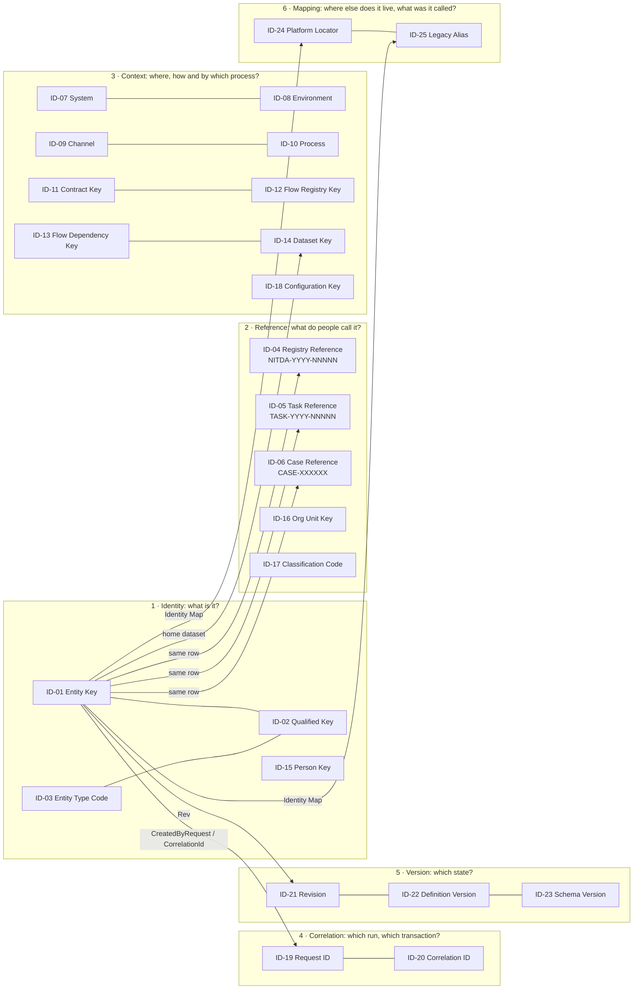
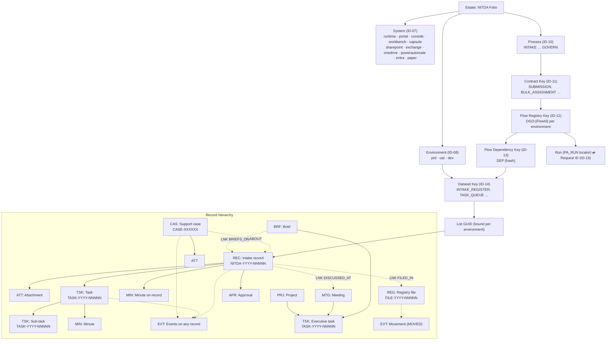
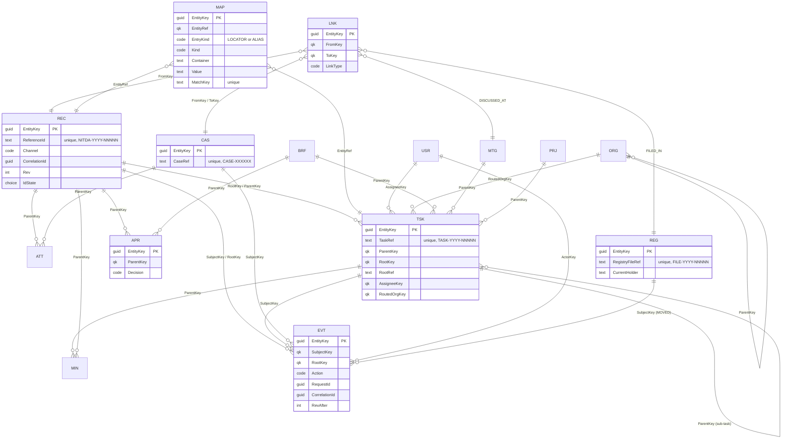
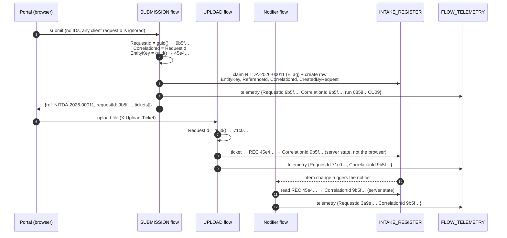
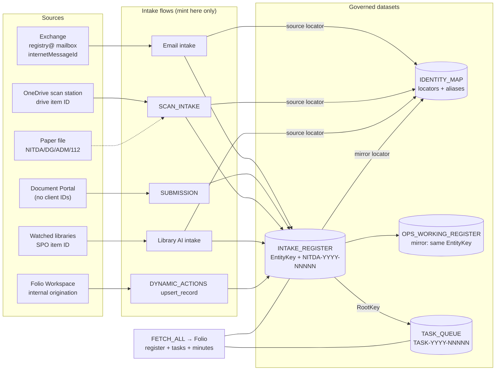
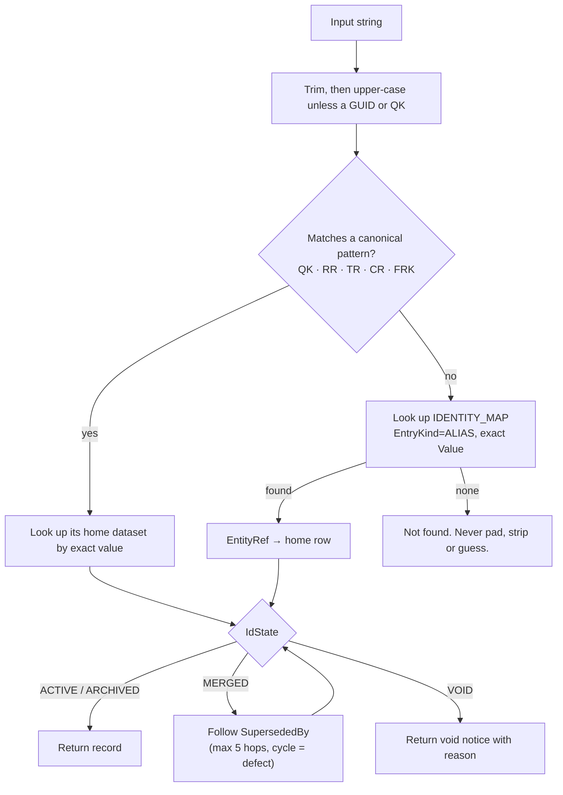
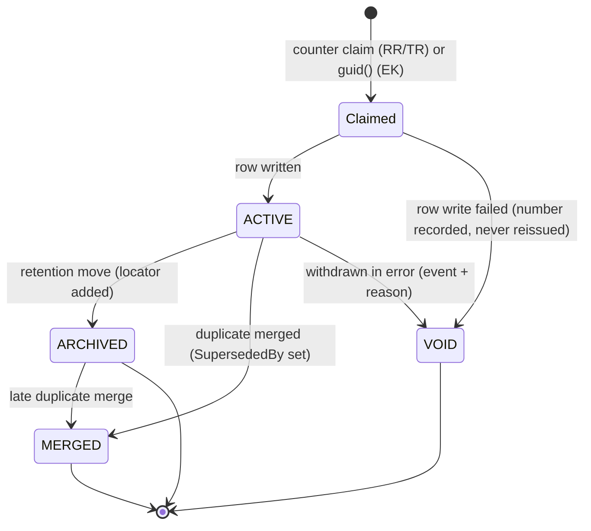
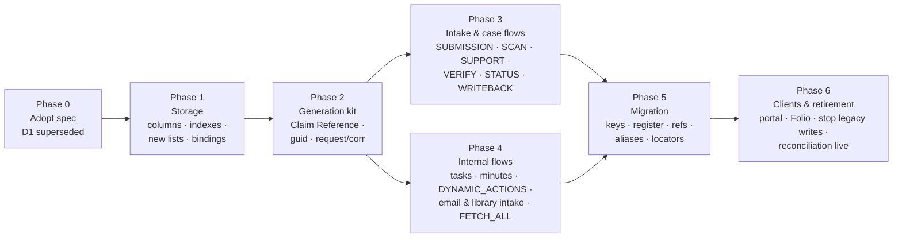

# NITDA Folio identification system

**Specification 1.2.7. Issued for implementation on 1 October 2026, amended 3, 4, 5, 6, 8 and 10 October 2026.** 1.1 added
the review amendments B1–B11 and Folio's executive and registry entities (§0). 1.2 adds flow and
endpoint naming, the Mailer and the Administration Centre as systems, and the trigger locator
(see *What changed in 1.2*, and §17).

The machine-readable source is [`identifier-catalogue.json`](identifier-catalogue.json). The sections
marked *generated* are rendered from it by `npm run idsystem`, and `npm run test:idsystem` validates
the design (see §14). Do not edit generated sections by hand.

This specification defines how every platform, process, dataset, record, activity and transaction
across NITDA Folio is identified, linked, traced and kept. It is the final design. It replaces the
interim findings and recommendations of the flow-failure diagnosis, and takes these decisions:

| # | Decision | Replaces |
|---|---|---|
| S1 | Every governed record carries an immutable, opaque **Entity Key**, minted in a flow. All relationships use it. | Linking on `RefIDD`, `Reference_ID`, SharePoint item IDs and titles |
| S2 | **Registry Reference `NITDA-YYYY-NNNNN`** is the one human reference for every registered item on every channel. The legacy live format is kept. | Foundational decision **D1** ("adopt unpadded `NITDA-YYYY-N`"), which is **superseded**. Its premise was a random `ticks()` sample, not a sequence. |
| S3 | **Task Reference `TASK-YYYY-NNNNN`** from a flow-held sequence. | The `Reference_ID` composite, which embeds changeable category codes and row numbers, and `TASK-<item ID>`, which is a platform row number. Both are kept as resolvable aliases. |
| S4 | **Case Reference `CASE-XXXXXX`**. The legacy live format is kept. | `CASE-YYYYMMDD-XXXXXX` and the browser's `NITDA-S-XXXXXX` |
| S5 | Canonical references are matched **exactly**. Legacy forms resolve only through the Identity Map and are never padded or stripped automatically. | "Lookups accept unpadded forms", which would make `NITDA-2026-217` (a legacy random value) find the unrelated `NITDA-2026-00217` |
| S6 | Duplicate detection is a flow **query** on indexed attributes. No fingerprint identifier is created. | The proposed `LocalId` fingerprint, which embedded the sender's email address |
| S7 | One **Intake Register** (`INTAKE_REGISTER`) holds a row for every received item on every channel. Every intake flow writes to it. | Four channels tracked in four places, two of which Folio never reads |
| S8 | **No identifier is created anywhere but in a flow** (runtime identifiers), or by change control (codes). Browsers and clients never mint. | `PF.uid()`, `sref()`, `core/reference-minter.js`, client `requestId` and `ref` |
| S9 | **Folio's own records are governed entities**: briefs `BRF`, meetings `MTG`, projects `PRJ`, approvals `APR` and registry files `REG`, with **File Reference `FILE-YYYY-NNNNN`**. Executive tasks are the same `TSK` entity as registry tasks. File movements, dispatches, escalations and audit entries are events. | Browser keys `BRF-`/`MTG-`/`PRJ-`/`TSK-<uuid>`, `APR-<ms>`, `REG-`/`MOV-`, `REF-YYYY-<ms>`, and `DGO/YYYY/NNNNNN` padded from a row number |
| S10 | **Coverage is enforced, not claimed.** Every place the code mints a value is recorded in the catalogue with a decision (§16). `test:idsystem` fails if code mints anything that isn't recorded, or if a record no longer matches the code. | A design that only lists the formats its authors happened to find |

## What changed in 1.2.7

- **The contract key `ACTIVITY_LIFECYCLE` is added** (owner decision, 10 October 2026; ITEM-25). Folio's Activities
  shortcuts (`activity-archive`, `activity-siwes`, `activity-nysc`, each as `:create-queue-record`, `:set-reference-id`,
  `:update-activity`) are served by their own flow, IP_Activity_Lifecycle_Endpoint (b4db02d8), because `DYNAMIC_ACTIONS`
  has no room under the service's 500-action limit. Its process is `ACTION`; the queue row it writes carries an Entity Key.

## What changed in 1.2.6

- **The contract key `USER_ADMIN` is added** (owner approval, 8 October 2026; ITEM-25). Folio's User Administration
  (`user-admin:create-user`, `update-user`, `assign-role`, `disable-user`) is served by its own flow,
  IP_User_Admin_Endpoint (e3e5c825), because `DYNAMIC_ACTIONS` has no room under the service's 500-action limit. Its
  process is `GOVERN` (access); it mints no identifier of its own beyond the directory row's `UserId` and Entity Key.

## What changed in 1.2.5

- **The contract key `BULK_ASSIGNMENT_DIRECT` is retired** (owner decision, 6 October 2026). Nothing in Folio called it;
  bulk assignment is `BULK_ASSIGNMENT`, served by BULK_OPS_DATA_RETRIEVAL_HTTP (5aab9e61), which holds the consolidated
  bulk scope. The key is removed from `contractKeyProcess`, the Task Reference generation rule and the Contract Key
  example. Per the Contract Key lifecycle, the retired key stays reserved and is not reused. The retirement is recorded in
  `docs/folio-Master-Flows-and-Endpoints/registers/flow-adoption.json` (`retiredContractKeys`).

## What changed in 1.2.4

- **DEV_OPS_Global_Tracking_Queue is a test list, not a mirror of the task queue** (owner direction, 5 October 2026).
  Tasks are created in Global Tracking Queue (`TASK_QUEUE`) only. 1.0 to 1.2.3 gave the list the role *mirror*,
  which no flow bears out: none copies Global Tracking Queue rows into it, and the flows that write it create tasks
  there directly (the email-to-task flow, the bulk-assignment case of Universal Dynamic_Multi-Actions_Executor and
  bulk Assign direct). The dataset `TASK_QUEUE_MIRROR` keeps its key, with role *test*, so the columns Phase 1
  added stay accounted for; its rows are not keyed, referenced, mapped or migrated, and no new flow writes it.

## What changed in 1.2.3

- **Files about a flow are named for the endpoint, the flow and the tenant flow** (§17, *Flow artefact file*):
  `<CONTRACT_KEY>__<FlowName>__<flow-id8>[__<Part>].<kind>`, for example
  `SUBMISSION__CG_Submission_Endpoint__de9ef13b.paste.json`: the contract key, the tenant display name, and the first 8 hex
  digits of the flow GUID (held unique across the estate; the full GUID is in the package READMEs), with a part only when a
  folder holds more than one file of that kind for the flow. A package
  named only for its flow (`CG_Submission_Endpoint.paste.json`) or its key (`BULK_ASSIGNMENT.paste.json`) was read by the
  estate register as a flow of its own, and two files about one flow did not sort together, which is the opposite of what
  weeding out duplicate and unwanted flows needs (owner direction, 5 October 2026). The identification packages are
  renamed; other flow files are reported by `npm run flowfiles` and adopt the form as their generators are next changed.

## What changed in 1.2.2

- **The Claim Reference block makes up to 10 attempts, with a random 1 to 5 s Delay between them** (was 5 attempts, 1 to
  3 s). In the Phase 2 tenant test on 4 October 2026, 20 parallel claims with 5 attempts gave 18 numbers, distinct and
  gap-free, and 2 claims ran out of attempts. With claims arriving together, about one claim wins per Delay slot per
  round, and a whole-second `rand(1,4)` gives only three slots, so 5 attempts cannot reliably meet the §13 exit
  criterion. 10 attempts with 1 to 5 s can (owner decision, 4 October 2026). The worst case is about 55 s, inside the
  120 s HTTP response limit. The run reports are in `docs/folio-Master-Flows-and-Endpoints/packages/identification-phase2/`.

## What changed in 1.2.1

- **The REG reference column is `RegistryFileRef`, not `FileRef`.** `FileRef` is SharePoint's own system column
  (every item's server-relative URL), so a custom column of that internal name cannot be created. The Phase 1
  provisioning run on 4 October 2026 confirmed it on the new `DGO_RegistryFiles` list (owner decision Q5). The
  identifier itself (ID-26, `FILE-YYYY-NNNNN`) is unchanged.
- **List IDs of the lists Phase 1 created** are not written into the catalogue: flows read every binding from Flow
  Configuration (`DATASET_<KEY>_LIST_ID`), and those rows were written by the provisioning run. The IDs are recorded in
  the Phase 1 evidence (`docs/folio-Master-Flows-and-Endpoints/packages/identification-phase1/`).

## What changed in 1.2

Measured on 3 October 2026: the catalogue identified flows only once registered, covered the
Workspace's and the Portal's endpoint keys but not the Mailer's, named five of the seven platforms
as systems, recorded the 32-hex workflow ID in registers without a place in the model, and set no
rule for a flow's display name or a Vault alias, so the tenant holds several styles for one kind of
flow and two alias forms were in use.

| # | Amendment | Where |
|---|---|---|
| N1 | The Mailer (`mailer`) and the Administration Centre (`centre`) are Folio platforms and system codes. The Platform Hub is not: it is a local front page, holds no records and is not deployed. | ID-07, §7.3 |
| N2 | The Mailer's seven endpoint keys (`MAIL_SEND` … `MAIL_DATA`) are Contract Keys, each mapped to a process. | ID-11, §7.3 |
| N3 | The Flow Registry Key identifies every flow the estate requires, registered or not yet; the required set is `docs/folio-Master-Flows-and-Endpoints/reference/FLOW_REQUIREMENTS.md`, generated from the code. | ID-12 |
| N4 | The workflow ID a signed trigger address carries is a locator, `PA_TRIGGER`, held against the Flow Registry Key. It is never the flow's identity. | ID-24, §7.4 |
| N5 | Flow display names and Vault aliases follow one rule each. Both are attributes, never keys (§11.5 is unchanged). Existing flow names stay, as `PLATFORM_NAMING.md` records. | §17 |

## 0. What changed in 1.1

| # | Amendment | Where |
|---|---|---|
| B1 | The generation kit uses no variables, no Until loop and no Filter array. A pasted scope cannot declare variables, so keys are Compose actions and the claim is up to 10 flat attempts, each running only if the previous one failed. | §8.2, kit |
| B2 | Phase 1 adds every identity column **optional, non-unique, indexed only**. Required and enforce-unique are switched on in Phase 6, after the backfill and after every writer is converted. Legacy writers keep working meanwhile. | §10.3, §13 |
| B3 | Folio's idempotency key becomes a hashed dedupe token, `ClientRequestHash`, computed once per user action and carried unchanged by queued replays. Flows return the first result for a repeat within 7 days. | §8.3, §11.5 |
| B4 | A legacy ticks reference shared by two records stays resolvable for both: one alias row per record, flagged `Ambiguous`, resolved with the sender email. Phase 5 counts collisions first. | §7.1, ID-25 |
| B5 | The duplicate check reads a new derived attribute, `AttachmentHashSet`, written by SUBMISSION from the declared hashes. `SubmittedAtUtc` is indexed. | §8.3, §10.2 |
| B6 | Not adopted. Upload tickets already carry the indexed `SubmissionRef`, so ticket → record → Correlation ID works without a new column. | §6.5 |
| B7 | The notifier derives the Correlation ID from the record row; it is not called by SUBMISSION. | §6.5 |
| B8 | A VOID row carries `ReferenceId`, `Status = VOID`, `VoidReason` and the sender email validated before the claim: Portal Registry's required columns are `ReferenceId`, `SenderEmail` and `Status`. | §8.2 |
| B9 | Every governed update is the kit's Guarded Update block (HTTP MERGE with `IF-MATCH`). The standard Update item action cannot send `IF-MATCH` and is not used for governed rows. | §8.3 |
| B10 | Until migration, flows locate a target by `entityKey`, else by `spo:<listGuid>/<itemId>`, else refuse. | §8.3 |
| B11 | The Phase 1 read-only verifier reports required columns, free index slots, item counts and the state of every identity column per list before anything is written. Unique-blank behaviour needs a write, so it is probed in Phase 6 on a throwaway list. | §13, §10.3 |
| D6 | Folio's executive and registry records join the model (S9), and every browser minter is recorded with a decision (S10, §16). | §6, §16 |

---

## 1. Scope and binding rules

**In scope:** the seven Folio platforms (Workspace, Document Portal, Estate Console, Flow Workbench,
Vault, Correspondence Mailer, Administration Centre), every Power Automate flow, every SharePoint list and library they read or write, the
monitored mailboxes, the scan station, and the physical registry files that scans come from.

**The binding rules:**

1. **R-IMMUTABLE.** A primary identifier never changes after issue, and is never reused, even after a void.
2. **R-OPAQUE.** No primary identifier contains business information that can change: category, unit,
   channel, status, assignee, title or document date.
3. **R-FLOW-ONLY.** Runtime identifiers (Entity Keys, references, request and correlation IDs,
   revisions) are minted only inside flows. Codes (types, processes, datasets, units, categories,
   configuration keys) are assigned only through change control (§11).
4. **R-NO-ROWNUM.** Platform-assigned values (SharePoint item IDs, Graph message IDs, drive item IDs,
   run IDs, version labels) are **locators**. They are recorded in the Identity Map and never used as
   permanent references.
5. **R-NO-PII.** No identifier contains personal or sensitive data: names, email addresses, phone
   numbers, IP addresses, national IDs, or any part of a secret.
6. **R-PRESERVE.** Every identifier that was ever issued or shown stays resolvable, either as a
   canonical value or as a Legacy Alias.
7. **R-ENV.** Identifiers issued outside production can never be mistaken for production ones.

## 2. Design principles

| # | Principle | How the design meets it |
|---|---|---|
| P1 | Separate identity from reference | The Entity Key (machine, permanent, opaque) sits beside a short human reference on the same row. People quote the reference; systems join on the key. |
| P2 | One kind of key everywhere | Every governed row uses the same Entity Key format. A Qualified Key (`TYPE:key`) makes any pointer self-describing. |
| P3 | Hierarchy in columns, not in identifiers | Parents are held in `ParentKey`/`RootKey`. Re-parenting, merging or moving a record changes no identifier. |
| P4 | Few human references, each with one job | Only three are minted: registry, task and case. Attachments, minutes, events and links are cited through their parent's reference. |
| P5 | Codes are vocabularies, not data | Channels, systems, processes, datasets, units and categories are registered codes owned by a named role. |
| P6 | Platforms are mapped, not trusted | Each platform's own IDs are captured as locators with validity periods, so a migration or copy adds a row and breaks nothing. |
| P7 | History is append-only | Revisions, events and closed locators are kept. Merges and voids leave tombstones that still resolve. |
| P8 | Uniqueness by construction, then by constraint | Counters claimed with ETags and 122-bit random keys produce unique values. Enforce-unique columns and daily reconciliation check them independently. |
| P9 | Human-friendly where people touch it | Fixed short shapes. No I/O/0/1 in random references. Readable over the phone. 12–19 characters. |
| P10 | Extensible without redesign | A new entity type, channel, system, process or dataset is one catalogue row. The key and reference formats never change. |

## 3. Master identification model

Identifiers fall into six layers. Each layer answers one question.



**The core of the model is the governed record row.** Every row in a governed dataset carries the
same identity block:

```
EntityKey        45e40654-7a58-4301-a99c-99c31ced8cd2     ← identity (never changes)
ReferenceId      NITDA-2026-00011                         ← human reference (REC/TSK/CAS only)
ParentKey        —                                        ← structural position
RootKey          REC:45e40654-7a58-4301-a99c-99c31ced8cd2
RootRef          NITDA-2026-00011
Rev              3                                        ← version
IdState          ACTIVE                                   ← identity lifecycle
CorrelationId    cc52f6a1-11cb-4aad-85e6-4053f50fe5b8     ← originating transaction
CreatedByRequest 9b5f07a8-c697-4d6e-b290-63d27a8564dd     ← run that created it
```

## 4. Identifier hierarchy

There are two hierarchies: the **estate** (what runs and holds data) and the **record** (what was
received and what was done about it). They meet at the dataset: every record lives in a dataset,
and every flow that touches it is a dependency of that dataset.



**Parent, child, master and reference identifiers:**

| Role | Identifier | Where |
|---|---|---|
| **Master** | The Entity Key on the record's home row (the dataset whose role is `master`) | `EntityKey` |
| **Mirror** | The same Entity Key on a working copy (`OPS_WORKING_REGISTER`), plus a locator in the Identity Map | `EntityKey` (not unique across lists, unique within each) |
| **Parent** | The immediate parent's Qualified Key | `ParentKey` |
| **Root** | The root `REC`, `CAS`, `BRF`, `MTG`, `PRJ` or `REG` Qualified Key, plus its reference for search where it has one | `RootKey`, `RootRef` |
| **Reference** | The human reference of the record itself | `ReferenceId`, `TaskRef`, `CaseRef`, `RegistryFileRef` |
| **Cross-reference** | A typed link between two records | `RECORD_LINKS` (`FromKey`, `ToKey`, `LinkType`) |
| **Correlation** | The transaction and run that produced the row | `CorrelationId`, `CreatedByRequest` |

## 5. Identifier catalogue

### 5.1 Summary *(generated)*

<!-- BEGIN GENERATED: summary -->
| ID | Name | Layer | Format | Applies to | Owner |
|---|---|---|---|---|---|
| ID-01 | **Entity Key** | identity | Lower-case RFC 4122 version-4 GUID, 36 characters with hyphens. | Every row in a governed dataset: REC, ATT, TSK, MIN, CAS, EVT, LNK, MAP, ORG, BRF, MTG, PRJ, APR and REG | Platform Engineering Lead |
| ID-02 | **Qualified Key** | identity | <TYPE>:<entity key>. TYPE is a 3-letter entity type code (ID-03). | ParentKey, RootKey, SupersededBy, Link FromKey/ToKey, Event SubjectKey/ActorKey, Identity Map EntityRef, and any column that can point at more than one entity type | Platform Engineering Lead |
| ID-03 | **Entity Type Code** | identity | Three upper-case letters. | The fifteen entity types in the entity model | Folio Estate Owner |
| ID-04 | **Registry Reference** | reference | NITDA-YYYY-NNNNN. Non-production environments prefix Z (ZNITDA-YYYY-NNNNN). | REC, on every channel: portal, email, scan, library and internal origination, including outbound replies | Registry Manager |
| ID-05 | **Task Reference** | reference | TASK-YYYY-NNNNN. Non-production: ZTASK-YYYY-NNNNN. | TSK: single, bulk-created and sub-tasks | Task Operations Lead |
| ID-06 | **Case Reference** | reference | CASE-XXXXXX from the unambiguous alphabet ABCDEFGHJKLMNPQRSTUVWXYZ23456789 (no I, O, 0, 1). Non-production: ZCASE-XXXXXX. | CAS | Service Desk Lead |
| ID-07 | **System Code** | context | Lower-case slug, 2–24 characters. | The seven Folio platforms (ids kept as they are) and the external systems: SharePoint, Exchange, OneDrive, Power Automate, Entra and paper | Folio Estate Owner |
| ID-08 | **Environment Code** | context | prd \| uat \| dev. | Every flow, dataset binding, endpoint registration and Identity Map row | Folio Estate Owner |
| ID-09 | **Channel Code** | context | portal \| email \| scan \| library \| internal. | REC | Registry Manager |
| ID-10 | **Process Code** | context | Upper-case word, 3–10 letters. | Contract keys, flow registry rows and events | Folio Estate Owner |
| ID-11 | **Contract Key** | context | UPPER_SNAKE, at most 40 characters. | The endpoint contracts in docs/folio-Master-Flows-and-Endpoints/reference/endpoints | Platform Engineering Lead |
| ID-12 | **Flow Registry Key** | context | DGO:<FlowId>, where FlowId is the Power Automate flow GUID. | Every Power Automate flow the estate requires (docs/folio-Master-Flows-and-Endpoints/reference/FLOW_REQUIREMENTS | Platform Engineering Lead |
| ID-13 | **Flow Dependency Key** | context | DEP:<16 lower-case hex>. | Rows of DGO_HTTPFlowDependencies (a flow reads or writes a list, mailbox or connector) | Platform Engineering Lead |
| ID-14 | **Dataset Key** | context | UPPER_SNAKE, at most 40 characters. | Every dataset that holds or controls governed records | Platform Engineering Lead |
| ID-15 | **Person Key** | identity | Entra object ID: lower-case GUID. | USR: assignees, actors, minute authors, directory rows | Identity and Access Administrator |
| ID-16 | **Org Unit Key** | reference | 2–10 letters or digits, optionally followed by one hyphenated qualifier (SA-SP), no spaces, case as approved (for example eGD). | ORG | Organisation Structure Owner |
| ID-17 | **Classification Code** | reference | Three upper-case letters (category, then sub-category). | REC and TSK classification | Registry Manager |
| ID-18 | **Configuration Key** | context | UPPER_SNAKE, 3–64 characters. | Flow Configuration rows | Platform Engineering Lead |
| ID-19 | **Request ID** | correlation | Lower-case GUID v4. | Every flow run (HTTP, scheduled and automated) | Platform Engineering Lead |
| ID-20 | **Correlation ID** | correlation | Lower-case GUID v4. | Multi-flow transactions; root records (REC, CAS) and tasks keep their originating value | Platform Engineering Lead |
| ID-21 | **Revision Number** | version | Positive integer. | REC, TSK, CAS, ATT (metadata only), ORG, MAP, LNK | Platform Engineering Lead |
| ID-22 | **Definition Version** | version | sha:<16 lower-case hex>. | Flow definitions (repo and tenant exports) | Platform Engineering Lead |
| ID-23 | **Schema Version** | version | v<major>. | Endpoint contracts, governed list schemas, identifier-catalogue | Platform Engineering Lead |
| ID-24 | **Platform Locator** | mapping | Kind + Container + Value (see locatorKinds). | Every placement of a governed entity outside its home row, every source item of an intake, every flow run, and every flow trigger | Platform Engineering Lead |
| ID-25 | **Legacy Alias** | mapping | As originally issued (see aliasKinds), stored trimmed. | Legacy ticks references, browser-minted references and keys, portal tracking IDs, legacy task composites and displays, interim case references, legacy registry file numbers, legacy org keys | Registry Manager |
| ID-26 | **File Reference** | reference | FILE-YYYY-NNNNN. Non-production: ZFILE-YYYY-NNNNN. | REG | Registry Manager |
<!-- END GENERATED: summary -->

### 5.2 Identifier specifications *(generated)*

Each identifier is specified against the twelve required attributes.

<!-- BEGIN GENERATED: entries -->
### ID-01 Entity Key (`EK`)

| Attribute | Specification |
|---|---|
| 1. Name and purpose | **Entity Key.** The permanent, opaque machine identity of every governed record. Every relationship, map entry and event points at it. It never changes and is never shown as the main reference to people. |
| 2. Applies to | Every row in a governed dataset: REC, ATT, TSK, MIN, CAS, EVT, LNK, MAP, ORG, BRF, MTG, PRJ, APR and REG. Person rows use their Entra object ID instead (ID-15). |
| 3. Format and components | Lower-case RFC 4122 version-4 GUID, 36 characters with hyphens.<br>`GUID`: 122 random bits, from Power Automate guid().<br>Pattern: `^[0-9a-f]{8}-[0-9a-f]{4}-4[0-9a-f]{3}-[89ab][0-9a-f]{3}-[0-9a-f]{12}$` |
| 4. Generation | Inside the flow that creates the record, as a Compose action (Compose_EntityKey = guid()) placed before the first write. A Compose is evaluated once per run, so every retry of the write inside that run reuses the same value. No variable is used: a pasted scope cannot declare one. Backfill flows use the same Compose per row. Requests replayed by Folio are matched by ClientRequestHash (see exclusions), so a replay never mints a second key. |
| 5. Uniqueness boundary | Global: across every dataset, entity type, environment and system. 2^122 random space; the dataset's unique column constraint is a second check. |
| 6. Permanence and mutability | Immutable. It doesn't change on status change, reclassification, re-assignment, rename, move, archive or merge. It is never reused, including after a record is withdrawn. |
| 7. Validation | Matches the pattern (lower case, version nibble 4, variant 8/9/a/b).<br>Unique in its home dataset (indexed, enforce-unique column).<br>Present on every row; a row without one is a migration defect that reconciliation reports. |
| 8. Relationships | Prefixed with the entity type code, it forms the Qualified Key (ID-02).<br>ParentKey and RootKey on child rows hold Qualified Keys built from it.<br>Mirror rows (OPS_WORKING_REGISTER) carry the same value as their master row.<br>Human references (ID-04/05/06) are stored beside it on the same row. |
| 9. Storage and mapping | Column EntityKey, single line of text (36), required, indexed, enforce unique, on every governed list and library.<br>JSON field entityKey in every API payload.<br>Folio domain field id. |
| 10. Examples | `45e40654-7a58-4301-a99c-99c31ced8cd2`: The register row for portal submission NITDA-2026-00011.<br>`e3f7d701-1693-4ab8-b725-025c93bf4372`: The task TASK-2026-00417 raised from it.<br>**Not valid:** `45E40654-7A58-4301-A99C-99C31CED8CD2`: Upper case. Keys are stored and compared in lower case.<br>`12907`: A SharePoint item ID is a locator (ID-24), not a key. |
| 11. Lifecycle and retirement | Issued at creation and kept for good. A record that is merged, voided or archived keeps its EK, which stays resolvable as a tombstone or redirect. Deleting a governed row is not allowed: withdraw it with IdState VOID instead. |
| 12. Governance owner | Platform Engineering Lead (DGO Digital Ops (flow engineering)) |

### ID-02 Qualified Key (`QK`)

| Attribute | Specification |
|---|---|
| 1. Name and purpose | **Qualified Key.** A self-describing reference to a record of any type. Use it in every column or field that can point at more than one entity type, so a reader never has to guess which list to look in. |
| 2. Applies to | ParentKey, RootKey, SupersededBy, Link FromKey/ToKey, Event SubjectKey/ActorKey, Identity Map EntityRef, and any column that can point at more than one entity type. |
| 3. Format and components | <TYPE>:<entity key>. TYPE is a 3-letter entity type code (ID-03).<br>`TYPE`: A registered entity type code (ID-03).<br>`:`: Separator.<br>`key`: The Entity Key (ID-01) or, for USR, the Entra object ID (ID-15).<br>Pattern: `^(REC|ATT|TSK|MIN|CAS|EVT|LNK|MAP|USR|ORG|BRF|MTG|PRJ|APR|REG):[0-9a-f]{8}-[0-9a-f]{4}-[0-9a-f]{4}-[0-9a-f]{4}-[0-9a-f]{12}$` |
| 4. Generation | Derived, never minted: concat(TypeCode, ':', EntityKey), built by the flow when it writes the referencing column. |
| 5. Uniqueness boundary | Global, because the Entity Key is global. The type prefix adds routing, not uniqueness. |
| 6. Permanence and mutability | Immutable, because both parts are. |
| 7. Validation | Matches the pattern.<br>TYPE is a registered code.<br>The key resolves to a row in TYPE's home dataset (checked by reconciliation; flows check it on write where they read the row anyway). |
| 8. Relationships | Wraps ID-01 or ID-15.<br>Hierarchy: ParentKey = parent's QK; RootKey = root REC/CAS QK.<br>Links and events use QKs on both ends. |
| 9. Storage and mapping | Single line of text (40), indexed wherever it is filtered (ParentKey, RootKey, SubjectKey, FromKey, ToKey).<br>JSON fields parentKey, rootKey, subjectKey, fromKey, toKey. |
| 10. Examples | `REC:45e40654-7a58-4301-a99c-99c31ced8cd2`: RootKey on every task, minute and event for submission NITDA-2026-00011.<br>`TSK:e3f7d701-1693-4ab8-b725-025c93bf4372`: ParentKey of sub-task TASK-2026-00418.<br>`USR:e1fae42c-aeb7-49c9-b4b1-54ac7faa16f5`: ActorKey of the officer who wrote a minute.<br>**Not valid:** `DGO:57f137b6-5cab-7991-4084-20605a3a9d43`: DGO is a reserved prefix (Flow Registry Key, ID-12), not an entity type.<br>`rec:45e40654-7a58-4301-a99c-99c31ced8cd2`: Type codes are upper case. |
| 11. Lifecycle and retirement | Follows the Entity Key it wraps. |
| 12. Governance owner | Platform Engineering Lead (DGO Digital Ops (flow engineering)) |

### ID-03 Entity Type Code (`TYPE`)

| Attribute | Specification |
|---|---|
| 1. Name and purpose | **Entity Type Code.** Names the kind of record a key belongs to and, through that, its home dataset. |
| 2. Applies to | The fifteen entity types in the entity model. |
| 3. Format and components | Three upper-case letters.<br>`code`: Mnemonic, registered in the catalogue, never reused.<br>Pattern: `^[A-Z]{3}$` |
| 4. Generation | Assigned by the Folio Estate Owner through change control and registered in identifier-catalogue.json. It is never generated at runtime. |
| 5. Uniqueness boundary | Unique in the catalogue. It may not equal a reserved prefix (DGO, DEP, SYS, NIT, TST, TMP, XXX). |
| 6. Permanence and mutability | Permanent. A retired type keeps its code reserved for good. |
| 7. Validation | Three upper-case letters.<br>Present in the entityTypes list.<br>Not in reservedTypeCodes. |
| 8. Relationships | The prefix of every Qualified Key.<br>Each type names exactly one home dataset (EVT has more than one event stream; each stream is registered). |
| 9. Storage and mapping | identifier-catalogue.json entityTypes; mirrored to Flow Configuration key ID_ENTITY_TYPES for flows. |
| 10. Examples | `REC`: Intake record.<br>`TSK`: Task.<br>**Not valid:** `DOC`: Well-formed but not registered. Documents are REC (the registered item) or ATT (the file). |
| 11. Lifecycle and retirement | Added by catalogue change. Retiring a type marks it deprecated; existing keys keep resolving. |
| 12. Governance owner | Folio Estate Owner (DGO Digital Ops) |

### ID-04 Registry Reference (`RR`)

| Attribute | Specification |
|---|---|
| 1. Name and purpose | **Registry Reference.** The one human reference for a registered item of correspondence or document. It is quoted by citizens, printed on acknowledgements and written on files. Preserved from the live legacy format. |
| 2. Applies to | REC, on every channel: portal, email, scan, library and internal origination, including outbound replies. |
| 3. Format and components | NITDA-YYYY-NNNNN. Non-production environments prefix Z (ZNITDA-YYYY-NNNNN).<br>`NITDA`: Fixed agency prefix (Z-prefixed outside production).<br>`YYYY`: Calendar year of issue in West Africa Time. It is not the document date, and correcting the document date doesn't change it.<br>`NNNNN`: That year's sequence, zero-padded to 5 digits. From 100000 it grows without padding, to at most 7 digits.<br>Pattern: `^Z?NITDA-(20[2-9]\d)-(\d{5}|[1-9]\d{5,6})$` |
| 4. Generation | Inside the intake flow only, from the SEQUENCE_COUNTERS row (Prefix='NITDA', Year=YYYY), using the kit's Claim Reference block: up to 10 flat attempts, each running only if the previous one failed, each a read plus an HTTP MERGE with IF-MATCH on the row's ETag, with a random 1-5 s Delay between attempts; no variables, no Until loop, no Filter array. Issued when the item is registered: at once for portal, scan and internal; at the triage 'register' action, or when the first task is raised, for email and library. |
| 5. Uniqueness boundary | Global within the environment. The sequence is shared by every channel, so one register holds one number line. Uniqueness comes from the counter claim, with the enforce-unique ReferenceId column as a second check. |
| 6. Permanence and mutability | Immutable once issued and never reused. Reclassification, re-routing, a change of channel, a change of document date or archiving leave it unchanged. A merged record's reference redirects to the surviving record. |
| 7. Validation | Matches the pattern exactly. Lookups compare the trimmed, upper-cased input. Shorter or 0-led 6-digit forms are legacy aliases (ID-25), never padded or stripped automatically.<br>In production, a leading Z is rejected.<br>Year <= current year; sequence <= the counter's CurrentSequence for that year.<br>Resolves to exactly one INTAKE_REGISTER row. |
| 8. Relationships | Stored beside the REC's Entity Key on the register row (1:1).<br>Copied as RootRef onto every child (ATT, TSK, MIN, EVT) for search. This is safe because it is immutable.<br>Support cases point at it with an ABOUT link; outbound replies with REPLIES_TO.<br>Legacy references (ticks, provisional, tracking ID) resolve to it through the Identity Map. |
| 9. Storage and mapping | INTAKE_REGISTER.ReferenceId (text 20, indexed, enforce unique) and Title.<br>OPS_WORKING_REGISTER.ReferenceId on the mirror row.<br>RootRef (text 20, indexed) on child rows.<br>SEQUENCE_COUNTERS.LastReferenceId.<br>JSON field ref (on REC) and rootRef (on children). |
| 10. Examples | `NITDA-2026-00011`: Live value issued 29 Sep 2026 to a portal submission.<br>`NITDA-2026-00012`: An email registered at triage the same day; same number line as the portal.<br>`NITDA-2027-00001`: First registration of 2027; the counter starts again.<br>`NITDA-2026-100000`: Sequence past 99999: grows, not truncated.<br>`ZNITDA-2026-00003`: Issued in UAT; can never be confused with production.<br>**Not valid:** `NITDA-2026-217`: Legacy ticks value: a Legacy Alias (ID-25), resolved by exact match.<br>`NITDA-2026-000011`: 0-led 6-digit form: not canonical.<br>`nitda-2026-00011 `: Not canonical as typed. Lookups trim and upper-case input first, but stored values must be exact. |
| 11. Lifecycle and retirement | Claimed, then issued with the row; ACTIVE for the life of the record. If the row write fails after the claim, the number is recorded as a VOID register row so the year's number line has no unexplained gaps. ARCHIVED and MERGED references still resolve. Never reused. |
| 12. Governance owner | Registry Manager (Central Registry) |

### ID-05 Task Reference (`TR`)

| Attribute | Specification |
|---|---|
| 1. Name and purpose | **Task Reference.** The human reference for a task, used in task emails, links and conversation. It replaces TASK-<item ID>, which was a platform row number. |
| 2. Applies to | TSK: single, bulk-created and sub-tasks. |
| 3. Format and components | TASK-YYYY-NNNNN. Non-production: ZTASK-YYYY-NNNNN.<br>`TASK`: Fixed prefix.<br>`YYYY`: Year of issue, West Africa Time.<br>`NNNNN`: That year's task sequence, padded to 5 digits and growing to at most 7.<br>Pattern: `^Z?TASK-(20[2-9]\d)-(\d{5}|[1-9]\d{5,6})$` |
| 4. Generation | Inside the task-creating flow (SINGLE_ASSIGNMENT, BULK_ASSIGNMENT, EMAIL_RELATED_TASK, DYNAMIC_ACTIONS sub-task), from the SEQUENCE_COUNTERS row (Prefix='TASK', Year=YYYY), with the kit's Claim Reference block (flat attempts, ETag MERGE). Bulk creation claims one block of n numbers in a single ETag update (CurrentSequence += n) and hands them out in order. |
| 5. Uniqueness boundary | Global within the environment. |
| 6. Permanence and mutability | Immutable and never reused. Re-assignment, re-parenting, a status change or a change of category leaves it unchanged. That is why category codes are not in it. |
| 7. Validation | Matches the pattern.<br>Resolves to exactly one TASK_QUEUE row.<br>A leading Z is rejected in production. |
| 8. Relationships | 1:1 with the task's Entity Key.<br>RootRef on the task gives the Registry Reference of the item it serves.<br>Sub-tasks get their own Task Reference; their parent is in ParentKey, not in the reference.<br>The legacy Reference_ID composite and TASK-<item ID> resolve to it as aliases. |
| 9. Storage and mapping | TASK_QUEUE.TaskRef (text 20, indexed, enforce unique).<br>Task email links: support.html?ref=TASK-2026-00417 (no item ID).<br>JSON field ref on TSK. |
| 10. Examples | `TASK-2026-00417`: Task raised on NITDA-2026-00011 for the Procurement unit.<br>`TASK-2026-00418`: Sub-task of TASK-2026-00417 (ParentKey = TSK:e3f7…).<br>`TASK-2024-03122`: A 2024 task given a reference during backfill; its old TASK-9120 still resolves.<br>**Not valid:** `TASK-12907`: Legacy display form (item ID): an alias.<br>`20260915-3482-CAS-PRC-12907`: Legacy composite: it embeds category codes and row numbers, so it is an alias. |
| 11. Lifecycle and retirement | Issued at task creation. Stays ACTIVE when the task is closed. A task withdrawn in error is VOID, and its number is never reissued. |
| 12. Governance owner | Task Operations Lead (DGO Digital Ops) |

### ID-06 Case Reference (`CR`)

| Attribute | Specification |
|---|---|
| 1. Name and purpose | **Case Reference.** The human reference for a support case. Preserved from the live legacy CG_Support_Endpoint format. It is deliberately not sequential, so a citizen can't guess the size or neighbours of the case register. |
| 2. Applies to | CAS. |
| 3. Format and components | CASE-XXXXXX from the unambiguous alphabet ABCDEFGHJKLMNPQRSTUVWXYZ23456789 (no I, O, 0, 1). Non-production: ZCASE-XXXXXX.<br>`CASE`: Fixed prefix.<br>`XXXXXX`: 6 characters, each chosen with rand(0,32) from the 32-character alphabet (2^30 combinations).<br>Pattern: `^Z?CASE-[A-HJ-NP-Z2-9]{6}$` |
| 4. Generation | Inside the SUPPORT flow only, with rand(). The flow checks that the value is not already in SUPPORT_CASES.CaseRef and draws again, up to 5 times. Any ref sent by the client is ignored. |
| 5. Uniqueness boundary | Global within the environment. Enforced by the existence check and the enforce-unique CaseRef column. |
| 6. Permanence and mutability | Immutable, never reused. |
| 7. Validation | Matches the pattern after upper-casing input.<br>Resolves to exactly one SUPPORT_CASES row. |
| 8. Relationships | 1:1 with the case's Entity Key.<br>ABOUT link to a REC when the case concerns a submission (replaces the free-text AboutReference). |
| 9. Storage and mapping | SUPPORT_CASES.CaseRef (text 12, indexed, enforce unique) and Title.<br>JSON field ref on CAS. |
| 10. Examples | `CASE-K7P2QX`: Citizen asks about NITDA-2026-00011; ABOUT link created.<br>`ZCASE-M3W9RT`: UAT case.<br>**Not valid:** `CASE-20260930-4F9A1C`: Interim rebuild format: an alias.<br>`CASE-K7P2Q0`: 0 is not in the alphabet.<br>`NITDA-S-4KQ7BM`: Browser-minted: an alias, if any were ever persisted. |
| 11. Lifecycle and retirement | Issued at case creation and kept after closure. A case closed by the scheduled sweep is still resolvable. Never reused. |
| 12. Governance owner | Service Desk Lead (Customer Service) |

### ID-07 System Code (`SYS`)

| Attribute | Specification |
|---|---|
| 1. Name and purpose | **System Code.** Identifies a platform, or an external system that holds or produces data. It tells you where a locator points and which surface an action came from. |
| 2. Applies to | The seven Folio platforms (ids kept as they are) and the external systems: SharePoint, Exchange, OneDrive, Power Automate, Entra and paper. |
| 3. Format and components | Lower-case slug, 2–24 characters.<br>`slug`: Lower-case letters, digits and hyphen.<br>Pattern: `^[a-z][a-z0-9-]{1,23}$` |
| 4. Generation | Assigned through catalogue change. Folio platform ids are inherited from config/brand.config.js and are never renamed. |
| 5. Uniqueness boundary | Unique in the catalogue's systems list. |
| 6. Permanence and mutability | Permanent. A renamed product keeps its code; the display name changes in brand.config.js. |
| 7. Validation | Pattern; present in the systems list. |
| 8. Relationships | Identity Map rows carry a System Code with every locator.<br>Events carry the Origin system (for example runtime or portal). |
| 9. Storage and mapping | identifier-catalogue.json systems; Identity Map column System (choice); Event column Origin. |
| 10. Examples | `runtime`: An assignment made in Folio Workspace.<br>`exchange`: The locator of an inbound email.<br>**Not valid:** `DGO R11.6 Runtime`: A display name, not a code. |
| 11. Lifecycle and retirement | A retired system's code is kept for historical map rows and never reassigned. |
| 12. Governance owner | Folio Estate Owner (DGO Digital Ops) |

### ID-08 Environment Code (`ENV`)

| Attribute | Specification |
|---|---|
| 1. Name and purpose | **Environment Code.** Separates production from non-production identity spaces, so a test record can never be mistaken for, or collide with, a real one. |
| 2. Applies to | Every flow, dataset binding, endpoint registration and Identity Map row. |
| 3. Format and components | prd \| uat \| dev.<br>`code`: Fixed vocabulary.<br>Pattern: `^(prd|uat|dev)$` |
| 4. Generation | Set once per environment in Flow Configuration (ENVIRONMENT_CODE). Flows read it to choose the human-reference prefix: '' in prd, 'Z' elsewhere. |
| 5. Uniqueness boundary | Unique per environment. |
| 6. Permanence and mutability | Permanent. |
| 7. Validation | Pattern.<br>In prd no issued human reference may start with Z; outside prd every one must. |
| 8. Relationships | Dataset Keys bind to one list GUID per environment.<br>Flow Registry Keys are per environment by nature (FlowId differs). |
| 9. Storage and mapping | Flow Configuration ENVIRONMENT_CODE; DGO_EndpointRegistry.Environment; Identity Map column Environment. |
| 10. Examples | `prd`: Live tenant.<br>`uat`: Acceptance copy of the flows and lists.<br>**Not valid:** `Production`: A display name. |
| 11. Lifecycle and retirement | Fixed. |
| 12. Governance owner | Folio Estate Owner (DGO Digital Ops) |

### ID-09 Channel Code (`CH`)

| Attribute | Specification |
|---|---|
| 1. Name and purpose | **Channel Code.** Records which entry point an item arrived through (decision D4). It is an attribute, so it is never part of the reference: an item re-registered from another channel keeps its reference. |
| 2. Applies to | REC. |
| 3. Format and components | portal \| email \| scan \| library \| internal.<br>`code`: Fixed vocabulary, mapped to D4 codes A, B, C, C' and D.<br>Pattern: `^(portal|email|scan|library|internal)$` |
| 4. Generation | Stamped by the intake flow from the trigger it serves, never sent by the client. |
| 5. Uniqueness boundary | Vocabulary. |
| 6. Permanence and mutability | Set at receipt. Mutable only by an audited correction event, and the reference is unaffected. |
| 7. Validation | Pattern; legacy display values ('Document Portal') map through the channels list. |
| 8. Relationships | With the Identity Map source locator, it gives source-to-record traceability. |
| 9. Storage and mapping | INTAKE_REGISTER.Channel (choice); JSON field channel. |
| 10. Examples | `portal`: NITDA-2026-00011.<br>`email`: NITDA-2026-00012.<br>**Not valid:** `Document Portal`: Legacy display value; stored values are codes. |
| 11. Lifecycle and retirement | Vocabulary extended by catalogue change only. |
| 12. Governance owner | Registry Manager (Central Registry) |

### ID-10 Process Code (`PRC`)

| Attribute | Specification |
|---|---|
| 1. Name and purpose | **Process Code.** Names the business process a flow, endpoint or event belongs to, which gives process-to-data and cross-functional reporting. |
| 2. Applies to | Contract keys, flow registry rows and events. |
| 3. Format and components | Upper-case word, 3–10 letters.<br>`code`: Fixed vocabulary of 11 processes.<br>Pattern: `^[A-Z]{3,10}$` |
| 4. Generation | Assigned through catalogue change. |
| 5. Uniqueness boundary | Unique in the processes list. |
| 6. Permanence and mutability | Permanent; never reused. |
| 7. Validation | Pattern; present in processes; every contract key maps to exactly one process. |
| 8. Relationships | Contract Key → Process (n:1).<br>Flow Registry row → Process.<br>Event.Process records which process acted. |
| 9. Storage and mapping | identifier-catalogue.json processes and contractKeyProcess; FLOW_REGISTRY column ProcessCode; Event column Process. |
| 10. Examples | `INTAKE`: SUBMISSION, UPLOAD, SCAN_INTAKE, WRITEBACK.<br>`ASSIGN`: SINGLE_ASSIGNMENT, BULK_ASSIGNMENT.<br>**Not valid:** `Intake`: Codes are upper case. |
| 11. Lifecycle and retirement | Vocabulary extended by catalogue change. |
| 12. Governance owner | Folio Estate Owner (DGO Digital Ops) |

### ID-11 Contract Key (`CK`)

| Attribute | Specification |
|---|---|
| 1. Name and purpose | **Contract Key.** The stable logical name of an HTTP capability the platforms call. Preserved as it is. It survives the flow behind it being rebuilt, moved to another environment or replaced. |
| 2. Applies to | The endpoint contracts in docs/folio-Master-Flows-and-Endpoints/reference/endpoints.json, plus SCAN_INTAKE, plus the Mailer's seven endpoint keys in mailer/flows/flows.catalogue.json. |
| 3. Format and components | UPPER_SNAKE, at most 40 characters.<br>`name`: Verb or noun phrase of what the endpoint does.<br>Pattern: `^[A-Z][A-Z0-9]*(_[A-Z0-9]+)*$` |
| 4. Generation | Assigned through change control when a new endpoint contract is defined. |
| 5. Uniqueness boundary | Unique across the estate (all environments share the key). |
| 6. Permanence and mutability | Permanent. A contract that changes incompatibly gets a new Schema Version (ID-23), not a new key. A retired key is never reused. |
| 7. Validation | Pattern; present in endpoints.json or the Mailer catalogue; mapped to a Process Code. |
| 8. Relationships | Contract Key → Flow Registry Key per environment (DGO_EndpointRegistry).<br>Telemetry and events record the Contract Key that served the request. |
| 9. Storage and mapping | docs/folio-Master-Flows-and-Endpoints/reference/endpoints.json; mailer/flows/flows.catalogue.json (endpointKey); DGO_EndpointRegistry.EndpointKey; telemetry column Flow; Event column ContractKey. |
| 10. Examples | `SUBMISSION`: Portal intake.<br>`BULK_ASSIGNMENT`: Bulk tasking.<br>**Not valid:** `CG_Submission_Endpoint`: A flow display name; it can change. |
| 11. Lifecycle and retirement | Active, then deprecated, then retired; retired keys stay reserved. |
| 12. Governance owner | Platform Engineering Lead (DGO Digital Ops (flow engineering)) |

### ID-12 Flow Registry Key (`FRK`)

| Attribute | Specification |
|---|---|
| 1. Name and purpose | **Flow Registry Key.** Identifies one deployed flow instance in one environment. Preserved from the HTTP flow registry. |
| 2. Applies to | Every Power Automate flow the estate requires (docs/folio-Master-Flows-and-Endpoints/reference/FLOW_REQUIREMENTS.md), registered in DGO_HTTPFlowRegistry or not yet. |
| 3. Format and components | DGO:<FlowId>, where FlowId is the Power Automate flow GUID.<br>`DGO`: Reserved registry prefix.<br>`FlowId`: Platform-assigned and immutable for that deployed flow.<br>Pattern: `^DGO:[0-9a-f]{8}-[0-9a-f]{4}-[0-9a-f]{4}-[0-9a-f]{4}-[0-9a-f]{12}$` |
| 4. Generation | Derived from the platform's FlowId: by the registry flow at registration, and by repository tooling (scripts/build-flow-requirements.mjs) for every required flow the tenant evidence names. |
| 5. Uniqueness boundary | Global (the FlowId is unique in the tenant). |
| 6. Permanence and mutability | Immutable for the deployed instance. A re-import into another environment is a new instance with a new key, linked by the same Contract Key. |
| 7. Validation | Pattern; for a registered flow, resolves to one FLOW_REGISTRY row. |
| 8. Relationships | n:1 to Contract Key (one per environment) and to Process Code.<br>1:n to Flow Dependency Keys.<br>Container of PA_RUN locators.<br>Container of the PA_TRIGGER locator: the 32-hex workflow ID its trigger address carries. |
| 9. Storage and mapping | FLOW_REGISTRY.RegistryKey; FLOW_DEPENDENCIES.RegistryKey; Identity Map Container for PA_RUN. |
| 10. Examples | `DGO:57f137b6-5cab-7991-4084-20605a3a9d43`: Bulk Assign Direct (registry seed).<br>**Not valid:** `Bulk Assign Direct`: A display name. |
| 11. Lifecycle and retirement | Registered, then active, then retired (05 - GOV - Retire HTTP Flow). Retired rows are kept. |
| 12. Governance owner | Platform Engineering Lead (DGO Digital Ops (flow engineering)) |

### ID-13 Flow Dependency Key (`DEP`)

| Attribute | Specification |
|---|---|
| 1. Name and purpose | **Flow Dependency Key.** Identifies one flow-to-resource dependency: the process-to-data edge. Preserved from the registry seed. |
| 2. Applies to | Rows of DGO_HTTPFlowDependencies (a flow reads or writes a list, mailbox or connector). |
| 3. Format and components | DEP:<16 lower-case hex>.<br>`DEP`: Reserved prefix.<br>`hash`: First 16 hex characters of SHA-256 over 'RegistryKey\|Direction\|DependencyType\|DependencyIdentifier', computed by repo tooling.<br>Pattern: `^DEP:[0-9a-f]{16}$` |
| 4. Generation | Computed by scripts/build-flow-registry-seed.mjs from the edge's own immutable parts. The same edge always gives the same key. |
| 5. Uniqueness boundary | Unique per edge; a collision would need identical inputs. |
| 6. Permanence and mutability | Immutable. A changed dependency is a new edge with a new key; the old edge is marked retired. |
| 7. Validation | Pattern; recomputing the hash from the row's columns reproduces it. |
| 8. Relationships | Joins Flow Registry Key to a list GUID, and through it to a Dataset Key. |
| 9. Storage and mapping | FLOW_DEPENDENCIES.DependencyKey. |
| 10. Examples | `DEP:2ed6737be6f4c95e`: A flow's downstream write to DGCEO_AttentionItems.<br>**Not valid:** `DEP:2ED6737BE6F4C95E`: Upper case. |
| 11. Lifecycle and retirement | Resolved, then retired. |
| 12. Governance owner | Platform Engineering Lead (DGO Digital Ops (flow engineering)) |

### ID-14 Dataset Key (`DSK`)

| Attribute | Specification |
|---|---|
| 1. Name and purpose | **Dataset Key.** The stable logical name of a list or library role (for example INTAKE_REGISTER). Flows and documentation bind to the role, and each environment binds the role to its own list GUID. This removes the ambiguity of same-named lists on several sites (DGO DIGITAL OPS exists on two). |
| 2. Applies to | Every dataset that holds or controls governed records. |
| 3. Format and components | UPPER_SNAKE, at most 40 characters.<br>`name`: The role, not the list's title.<br>Pattern: `^[A-Z][A-Z0-9]*(_[A-Z0-9]+)*$` |
| 4. Generation | Assigned through catalogue change. |
| 5. Uniqueness boundary | Unique in the catalogue's datasets list. |
| 6. Permanence and mutability | Permanent. Renaming the underlying list or moving it to another site changes only the binding. |
| 7. Validation | Pattern; for each environment exactly one bound list GUID; each governed dataset declares exactly one entity type. |
| 8. Relationships | Dataset Key → list GUID (per environment) → FLOW_DEPENDENCIES → Flow Registry Key → Contract Key → Process Code. |
| 9. Storage and mapping | identifier-catalogue.json datasets; Flow Configuration keys DATASET_<KEY>_LIST_ID per environment. |
| 10. Examples | `INTAKE_REGISTER`: Bound in prd to Portal Registry 4c49f66a-…<br>`TASK_QUEUE`: Bound in prd to Global Tracking Queue ee82725a-…<br>**Not valid:** `Portal Registry`: A list title. |
| 11. Lifecycle and retirement | Active, then retired (the binding is removed and the key stays reserved). |
| 12. Governance owner | Platform Engineering Lead (DGO Digital Ops (flow engineering)) |

### ID-15 Person Key (`USR`)

| Attribute | Specification |
|---|---|
| 1. Name and purpose | **Person Key.** The immutable identity of a member of staff or a service account. Email addresses and display names change; the Entra object ID does not. |
| 2. Applies to | USR: assignees, actors, minute authors, directory rows. |
| 3. Format and components | Entra object ID: lower-case GUID.<br>`oid`: Assigned by Microsoft Entra ID.<br>Pattern: `^[0-9a-f]{8}-[0-9a-f]{4}-[0-9a-f]{4}-[0-9a-f]{4}-[0-9a-f]{12}$` |
| 4. Generation | Read from Entra (Office 365 Users connector 'Id', or the token's oid claim) by the directory-sync flow. It is never typed by a person or minted. |
| 5. Uniqueness boundary | Tenant-wide. |
| 6. Permanence and mutability | Immutable for the life of the account. A leaver's key stays in history; it is never reassigned. |
| 7. Validation | Pattern; resolves in USER_DIRECTORY.UserId. |
| 8. Relationships | ActorKey (USR:<oid>) on events; AssigneeKey on tasks; Author on minutes.<br>Email stays an attribute for display and delivery. |
| 9. Storage and mapping | USER_DIRECTORY.UserId (text 36, indexed, enforce unique); task column AssigneeKey; event ActorKey. |
| 10. Examples | `e1fae42c-aeb7-49c9-b4b1-54ac7faa16f5`: The officer assigned TASK-2026-00417.<br>**Not valid:** `a.officer@nitda.gov.ng`: Email is mutable and personal: an attribute, never a key. |
| 11. Lifecycle and retirement | Active, then disabled (DisabledReason), and kept. |
| 12. Governance owner | Identity and Access Administrator (Information Technology Department) |

### ID-16 Org Unit Key (`OUK`)

| Attribute | Specification |
|---|---|
| 1. Name and purpose | **Org Unit Key.** The short human code of an organisation unit, used in routing and reports. Preserved from the approved organisational-units register. The machine identity is the unit's Entity Key. |
| 2. Applies to | ORG. |
| 3. Format and components | 2–10 letters or digits, optionally followed by one hyphenated qualifier (SA-SP), no spaces, case as approved (for example eGD).<br>`code`: Abbreviation of the unit's own name, approved by the owner.<br>Pattern: `^[A-Za-z][A-Za-z0-9]{1,9}(-[A-Za-z0-9]{1,8})?$` |
| 4. Generation | Assigned by the Organisation Structure Owner and recorded in docs/reference/approved/organizational-units.csv, from which config is generated. |
| 5. Uniqueness boundary | Unique among active and retired units, compared case-insensitively. |
| 6. Permanence and mutability | Kept while the unit exists. A renamed unit keeps its key. A merged or split unit gets a new key and the old one is retired, with a SUPERSEDES chain on the ORG rows. Keys may not encode headship status (acting or substantive), which is an attribute. |
| 7. Validation | Pattern; unique case-insensitively; present in the register. |
| 8. Relationships | ORG Entity Key (1:1); tasks carry RoutedOrgKey (QK) plus OrgUnitKey for display; ORG.ParentKey gives the directorate hierarchy. |
| 9. Storage and mapping | ORG_DIRECTORY.UnitKey (indexed, unique) and EntityKey; config/organizational-units.config.js key. |
| 10. Examples | `CPS`: Corporate Planning and Strategy.<br>`eGD`: e-Government Department.<br>`SA-SP`: A Special Assistant's office (qualifier form).<br>**Not valid:** `Ag DGCEO`: Embeds acting status and a space: kept as a Legacy Alias of CEO. |
| 11. Lifecycle and retirement | Active, then retired when the unit is dissolved. Retired keys are never reassigned to a different unit. |
| 12. Governance owner | Organisation Structure Owner (Human Resource Management with Corporate Planning and Strategy) |

### ID-17 Classification Code (`CLS`)

| Attribute | Specification |
|---|---|
| 1. Name and purpose | **Classification Code.** Codes for category and sub-category, used for filtering and reporting. Preserved from the Categories Matrix. They are attributes of a record and never part of any reference, because a record can be reclassified. |
| 2. Applies to | REC and TSK classification. |
| 3. Format and components | Three upper-case letters (category, then sub-category).<br>`code`: From config/category-matrix.config.js (Categories Matrix list).<br>Pattern: `^[A-Z]{3}$` |
| 4. Generation | Assigned by the Registry Manager in the Categories Matrix. |
| 5. Uniqueness boundary | A category code is unique among categories. A sub-category code is unique within its category. |
| 6. Permanence and mutability | A code keeps its meaning for good. Splitting or merging categories creates new codes and retires the old ones. |
| 7. Validation | Pattern; the pair exists in the matrix. |
| 8. Relationships | Attribute of REC/TSK. Reclassification writes an EVT and changes no identifier. |
| 9. Storage and mapping | CategoryCode and SubCategoryCode columns; JSON fields categoryCode, subCategoryCode. |
| 10. Examples | `CAS`: Contracts and Services.<br>`PRC`: Procurement (under CAS).<br>**Not valid:** `CAT`: Well-formed but not in the matrix: the legacy fallback for a missing category. The record is unclassified (UNC). |
| 11. Lifecycle and retirement | Active, then retired; retired codes stay in history. |
| 12. Governance owner | Registry Manager (Central Registry) |

### ID-18 Configuration Key (`CFG`)

| Attribute | Specification |
|---|---|
| 1. Name and purpose | **Configuration Key.** Names a setting in Flow Configuration. Preserved as it is. |
| 2. Applies to | Flow Configuration rows. |
| 3. Format and components | UPPER_SNAKE, 3–64 characters.<br>`name`: What the setting controls.<br>Pattern: `^[A-Z][A-Z0-9_]{2,63}$` |
| 4. Generation | Assigned by Platform Engineering. |
| 5. Uniqueness boundary | Unique per environment (Title column). |
| 6. Permanence and mutability | Permanent. A renamed setting gets a new key and the old one is retired. |
| 7. Validation | Pattern; present in Flow Configuration. |
| 8. Relationships | Binds Dataset Keys (DATASET_<KEY>_LIST_ID) and the environment (ENVIRONMENT_CODE). |
| 9. Storage and mapping | FLOW_CONFIGURATION.Title. |
| 10. Examples | `NOTIFY_REGISTRY_TO`: Registry alert recipient.<br>`ENVIRONMENT_CODE`: prd, uat or dev.<br>**Not valid:** `notify registry to`: Not UPPER_SNAKE. |
| 11. Lifecycle and retirement | Active, then retired. |
| 12. Governance owner | Platform Engineering Lead (DGO Digital Ops (flow engineering)) |

### ID-19 Request ID (`RID`)

| Attribute | Specification |
|---|---|
| 1. Name and purpose | **Request ID.** Identifies one flow invocation, so a response, its telemetry row, any failure alert and every row it wrote can be tied together. |
| 2. Applies to | Every flow run (HTTP, scheduled and automated). |
| 3. Format and components | Lower-case GUID v4.<br>`GUID`: guid() in the trigger's first action.<br>Pattern: `^[0-9a-f]{8}-[0-9a-f]{4}-4[0-9a-f]{3}-[89ab][0-9a-f]{3}-[0-9a-f]{12}$` |
| 4. Generation | Always minted by the flow. A client value (requestId body field or X-Correlation-ID header) is never adopted. It is kept, sanitised and cut to 64 characters, as ClientCorrelationId in telemetry only. |
| 5. Uniqueness boundary | Global. |
| 6. Permanence and mutability | Immutable. |
| 7. Validation | Pattern; one FLOW_TELEMETRY row per Request ID. |
| 8. Relationships | Telemetry row (1:1); rows created by the run carry it as CreatedByRequest; events carry it as RequestId.<br>Run locator (PA_RUN) stored beside it. |
| 9. Storage and mapping | FLOW_TELEMETRY.RequestId (indexed); CreatedByRequest on governed rows; Event.RequestId; response field requestId. |
| 10. Examples | `9b5f07a8-c697-4d6e-b290-63d27a8564dd`: The SUBMISSION run that issued NITDA-2026-00011.<br>**Not valid:** `client-abc-123`: Client-supplied: kept as ClientCorrelationId only. |
| 11. Lifecycle and retirement | Kept for as long as the telemetry retention period, and for as long as any row that carries it. |
| 12. Governance owner | Platform Engineering Lead (DGO Digital Ops (flow engineering)) |

### ID-20 Correlation ID (`CID`)

| Attribute | Specification |
|---|---|
| 1. Name and purpose | **Correlation ID.** Ties together every run in one business transaction that spans several flows: submission, its uploads and its notifications, or a bulk assignment and the emails it sends. |
| 2. Applies to | Multi-flow transactions; root records (REC, CAS) and tasks keep their originating value. |
| 3. Format and components | Lower-case GUID v4.<br>`GUID`: Equal to the Request ID of the run that started the transaction.<br>Pattern: `^[0-9a-f]{8}-[0-9a-f]{4}-4[0-9a-f]{3}-[89ab][0-9a-f]{3}-[0-9a-f]{12}$` |
| 4. Generation | The originating flow sets CorrelationId = its own Request ID. Downstream flows receive it from a calling flow (server to server), or derive it from server state (upload ticket → REC → CorrelationId). They never take it from the browser. |
| 5. Uniqueness boundary | Global; shared on purpose by the runs of one transaction. |
| 6. Permanence and mutability | Immutable. |
| 7. Validation | Pattern; equals the RequestId of an existing telemetry row. |
| 8. Relationships | One Correlation ID to many Request IDs.<br>Stored on the root record, so record-to-activity queries can pull every run that touched it. |
| 9. Storage and mapping | CorrelationId column on REC, CAS, TSK, EVT and FLOW_TELEMETRY (indexed). |
| 10. Examples | `cc52f6a1-11cb-4aad-85e6-4053f50fe5b8`: SUBMISSION plus three UPLOAD runs plus the registry notification for NITDA-2026-00011.<br>**Not valid:** `NITDA-2026-00011`: A reference, not a transaction ID. |
| 11. Lifecycle and retirement | Same as Request ID. |
| 12. Governance owner | Platform Engineering Lead (DGO Digital Ops (flow engineering)) |

### ID-21 Revision Number (`REV`)

| Attribute | Specification |
|---|---|
| 1. Name and purpose | **Revision Number.** Counts committed changes to a record, so history can be rebuilt and two edits can't silently overwrite each other. |
| 2. Applies to | REC, TSK, CAS, ATT (metadata only), ORG, MAP, LNK. |
| 3. Format and components | Positive integer.<br>`n`: 1 at creation; +1 per committed business change.<br>Pattern: `^[1-9]\d{0,5}$` |
| 4. Generation | The flow writing the change uses the kit's Guarded Update block: read the row and its ETag, then 'Send an HTTP request to SharePoint' (MERGE, IF-MATCH: <etag>) setting Rev = Rev+1 with the change. The standard Update item action cannot send IF-MATCH, so it is not used for governed rows. On 412 the block re-reads and re-applies, up to 3 flat attempts. Every change writes an EVT with RevAfter. |
| 5. Uniqueness boundary | Unique per record (EntityKey + Rev). |
| 6. Permanence and mutability | Each value is permanent history. The current value only increases. |
| 7. Validation | Integer >= 1; EVT rows for a record have strictly increasing RevAfter. |
| 8. Relationships | EVT.RevAfter points to the state after the event. A file's content never changes in place: new content is a new ATT with a SUPERSEDES link. |
| 9. Storage and mapping | Rev (number) on governed rows; EVT.RevAfter; JSON field rev. |
| 10. Examples | `1`: NITDA-2026-00011 at registration.<br>`4`: After classification, routing and closure.<br>**Not valid:** `1.0`: That is a SharePoint version label (platform locator), not the record revision. |
| 11. Lifecycle and retirement | Frozen when IdState becomes MERGED or VOID. |
| 12. Governance owner | Platform Engineering Lead (DGO Digital Ops (flow engineering)) |

### ID-22 Definition Version (`DV`)

| Attribute | Specification |
|---|---|
| 1. Name and purpose | **Definition Version.** Identifies the exact content of a flow definition, so the deployed flow can be proved equal to the repo's. Preserved from the registry seed. |
| 2. Applies to | Flow definitions (repo and tenant exports). |
| 3. Format and components | sha:<16 lower-case hex>.<br>`sha:`: Prefix.<br>`hash`: First 16 hex of SHA-256 over the canonical definition JSON.<br>Pattern: `^sha:[0-9a-f]{16}$` |
| 4. Generation | Computed by repo tooling (build-flow-registry-seed, flow harvest). |
| 5. Uniqueness boundary | Unique per definition content. |
| 6. Permanence and mutability | Immutable; a change to the definition gives a new value. |
| 7. Validation | Recomputing from the definition reproduces it. |
| 8. Relationships | Attribute of the Flow Registry Key (DefinitionVersion, DefinitionFingerprint). |
| 9. Storage and mapping | FLOW_REGISTRY.DefinitionVersion. |
| 10. Examples | `sha:046e21b99f1e454a`: Bulk Assign Direct as harvested.<br>**Not valid:** `v2`: That is a Schema Version. |
| 11. Lifecycle and retirement | Each deployed version stays in history. |
| 12. Governance owner | Platform Engineering Lead (DGO Digital Ops (flow engineering)) |

### ID-23 Schema Version (`SV`)

| Attribute | Specification |
|---|---|
| 1. Name and purpose | **Schema Version.** Versions a contract or document shape: an endpoint's request and response, a list schema, and this catalogue's structure. A consumer can then tell an incompatible change from a compatible one. |
| 2. Applies to | Endpoint contracts, governed list schemas, identifier-catalogue.json. |
| 3. Format and components | v<major>.<br>`major`: Incremented only for incompatible changes. Compatible additions don't change it.<br>Pattern: `^v[1-9]\d{0,2}$` |
| 4. Generation | Set by the contract owner when the contract changes. |
| 5. Uniqueness boundary | Per contract. |
| 6. Permanence and mutability | Each version is permanent; old versions are documented until retired. |
| 7. Validation | Pattern; payloads carry schemaVersion and flows reject an unknown major version. |
| 8. Relationships | Contract Key + Schema Version identifies one contract shape. |
| 9. Storage and mapping | endpoints.json; payload field schemaVersion; catalogue schemaVersion. |
| 10. Examples | `v1`: Current SUBMISSION contract.<br>**Not valid:** `1.2.0`: Release versions belong to package.json, not to contracts. |
| 11. Lifecycle and retirement | Active, deprecated, then retired. |
| 12. Governance owner | Platform Engineering Lead (DGO Digital Ops (flow engineering)) |

### ID-24 Platform Locator (`LOC`)

| Attribute | Specification |
|---|---|
| 1. Name and purpose | **Platform Locator.** Where a record physically lives in a platform: a SharePoint item, a mailbox message, a OneDrive file, a flow run, a paper file. Locators are recorded and mapped, but are never used as permanent identifiers, because platforms reassign them on copy, migration or move. |
| 2. Applies to | Every placement of a governed entity outside its home row, every source item of an intake, every flow run, and every flow trigger. |
| 3. Format and components | Kind + Container + Value (see locatorKinds).<br>`Kind`: From locatorKinds.<br>`Container`: List GUID, mailbox, drive, Flow Registry Key or registry location.<br>`Value`: The platform's own ID, as given.<br>Pattern: `^(SPO_ITEM|EXO_INTERNET_MESSAGE_ID|EXO_GRAPH_MESSAGE_ID|ODB_ITEM|PA_RUN|PA_TRIGGER|PAPER_FILE)$` |
| 4. Generation | Captured, not minted: read from the platform by the flow that places or reads the item. |
| 5. Uniqueness boundary | Unique per Kind + Container + Value, enforced by the Identity Map's MatchKey. |
| 6. Permanence and mutability | Valid for a period (ValidFromUtc to ValidToUtc). A move closes the old locator and opens a new one; nothing is overwritten. |
| 7. Validation | Value matches its kind's pattern; Container is known; no two open locators of the same kind and container for one entity. |
| 8. Relationships | Many locators to one Entity Key, through the Identity Map. |
| 9. Storage and mapping | IDENTITY_MAP rows with EntryKind=LOCATOR. The record's own home-list item ID is implicit and not mapped. |
| 10. Examples | `SPO_ITEM`: DGO DIGITAL OPS working row of NITDA-2026-00012 at item 22109.<br>`EXO_INTERNET_MESSAGE_ID`: Source email of NITDA-2026-00012.<br>**Not valid:** `RefIDD`: A column name, not a locator kind. |
| 11. Lifecycle and retirement | Opened at placement, closed (ValidToUtc) on move, archive or deletion of the copy. Closed rows are kept for audit. |
| 12. Governance owner | Platform Engineering Lead (DGO Digital Ops (flow engineering)) |

### ID-25 Legacy Alias (`ALS`)

| Attribute | Specification |
|---|---|
| 1. Name and purpose | **Legacy Alias.** Keeps every identifier that was ever issued or shown, but does not conform, resolvable to its canonical record. Nothing a citizen or officer holds stops working. |
| 2. Applies to | Legacy ticks references, browser-minted references and keys, portal tracking IDs, legacy task composites and displays, interim case references, legacy registry file numbers, legacy org keys. |
| 3. Format and components | As originally issued (see aliasKinds), stored trimmed.<br>`Kind`: From aliasKinds.<br>`Value`: The exact legacy string, trimmed, case preserved.<br>Pattern: `^(LEGACY_TICKS_REF|BROWSER_PROVISIONAL_REF|BROWSER_PADDED_REF|BROWSER_TIMESTAMP_REF|PORTAL_TRACKING_ID|PORTAL_SUPPORT_SREF|REBUILD_CASE_REF|LEGACY_TASK_COMPOSITE|LEGACY_TASK_DISPLAY|LEGACY_ORG_KEY|LEGACY_REGISTRY_FILE_NO|ENTITY_STORE_REF|APPROVAL_LOCAL_REF|FOLIO_LOCAL_KEY)$` |
| 4. Generation | Never generated. Registered by migration flows from existing data, once. |
| 5. Uniqueness boundary | An alias value maps to exactly one entity, except LEGACY_TICKS_REF: the old portal flows drew those at random, so two records can share one. Such a value is stored once per record with IdState ACTIVE and Ambiguous = true; its MatchKey includes the EntityRef. STATUS and WRITEBACK resolve an ambiguous value only together with the sender email the request already carries, and staff search lists every candidate. Externally issued kinds win over internal-only kinds when values conflict. |
| 6. Permanence and mutability | Permanent and read-only. No new alias values are created after migration, except when an external system's reference is captured as a locator. |
| 7. Validation | Value matches its kind's pattern.<br>Non-ambiguous values resolve to exactly one entity; an ambiguous value resolves to one entity once the sender email is applied.<br>Phase 5 counts ticks-reference collisions before loading any alias. |
| 8. Relationships | Many aliases to one Entity Key. |
| 9. Storage and mapping | IDENTITY_MAP rows with EntryKind=ALIAS. The legacy source column (Reference_ID, RefIDD, LocalId, Title) is left in place, read-only. |
| 10. Examples | `LEGACY_TICKS_REF`: NITDA-2026-217 resolves to the record now known as NITDA-2026-00009.<br>`LEGACY_TASK_DISPLAY`: TASK-12907 in an old email link resolves to TASK-2026-00211.<br>**Not valid:** `NITDA-2026-00011`: Canonical: never registered as an alias. |
| 11. Lifecycle and retirement | Registered at migration; kept for the retention life of the record. |
| 12. Governance owner | Registry Manager (Central Registry) |

### ID-26 File Reference (`FR`)

| Attribute | Specification |
|---|---|
| 1. Name and purpose | **File Reference.** The human reference of a registry file, written on the file jacket and quoted when a file moves between offices. It replaces DGO/YYYY/NNNNNN, which was padded from a SharePoint item ID or a timestamp. |
| 2. Applies to | REG. |
| 3. Format and components | FILE-YYYY-NNNNN. Non-production: ZFILE-YYYY-NNNNN.<br>`FILE`: Fixed prefix.<br>`YYYY`: Year the file was opened, West Africa Time.<br>`NNNNN`: That year's file sequence, padded to 5 digits and growing to at most 7.<br>Pattern: `^Z?FILE-(20[2-9]\d)-(\d{5}|[1-9]\d{5,6})$` |
| 4. Generation | Inside DYNAMIC_ACTIONS 'open_file' only, from the SEQUENCE_COUNTERS row (Prefix='FILE', Year=YYYY), with the kit's Claim Reference block. |
| 5. Uniqueness boundary | Global within the environment. |
| 6. Permanence and mutability | Immutable, never reused. A file that is closed and continued in a new volume keeps its reference; the new volume is a new REG with its own reference and a SUPERSEDES link to the old one. |
| 7. Validation | Matches the pattern.<br>Resolves to exactly one REGISTRY_FILES row.<br>A leading Z is rejected in production. |
| 8. Relationships | 1:1 with the file's Entity Key.<br>Records are filed with a FILED_IN link (REC to REG).<br>Movements are EVT rows (Action MOVED) on the file, in FILE_MOVEMENTS.<br>Legacy DGO/YYYY/NNNNNN numbers resolve to it as LEGACY_REGISTRY_FILE_NO aliases. |
| 9. Storage and mapping | REGISTRY_FILES.RegistryFileRef (text 20, indexed, enforce unique from Phase 6) and Title.<br>JSON field ref on REG. |
| 10. Examples | `FILE-2026-00042`: Registry file opened for NITDA-2026-00011 and its replies.<br>`ZFILE-2026-00002`: UAT file.<br>**Not valid:** `DGO/2026/000042`: Legacy Folio registry number built from a row number: an alias. |
| 11. Lifecycle and retirement | Issued when the file is opened; ACTIVE while open or closed; ARCHIVED when the file goes to the archive. Never reused. |
| 12. Governance owner | Registry Manager (Central Registry) |

<!-- END GENERATED: entries -->

## 6. Relationship and correlation model

### 6.1 Entity types *(generated)*

<!-- BEGIN GENERATED: entityTypes -->
| Code | Entity | Applies to | Home dataset | Human reference | Parent may be | Root |
|---|---|---|---|---|---|---|
| `REC` | Intake record | Every item of correspondence or document the Agency receives or originates, on any channel: portal submission, email, scanned paper, library drop, internally originated memo or letter, and outbound replies. | INTAKE_REGISTER | ID-04 | — | yes |
| `ATT` | Attachment | A stored file that belongs to a record: an uploaded attachment, a scanned image, an email attachment, a dispatched letter. | ATTACHMENTS | — | `REC`, `CAS`, `BRF`, `MTG`, `PRJ`, `REG` | no |
| `TSK` | Task | A unit of assigned work: registry tasks (Global Tracking Queue), sub-tasks, bulk-created tasks, and the executive register's tasks under a brief, meeting or project. One task entity for both. | TASK_QUEUE | ID-05 | `REC`, `TSK`, `BRF`, `MTG`, `PRJ` | no |
| `MIN` | Minute | A comment or minute written on a task, record, brief, meeting, project or registry file. | MINUTES | — | `TSK`, `REC`, `BRF`, `MTG`, `PRJ`, `REG` | no |
| `CAS` | Support case | A help request raised through the portal's support page. | SUPPORT_CASES | ID-06 | — | yes |
| `EVT` | Event | Anything that happened to a record: status change, assignment, verification, AI extraction, approval decision, registry file movement, email dispatch, escalation, access, audit entry. | STATUS_TIMELINE | — | `APR`, `ATT`, `BRF`, `CAS`, `LNK`, `MIN`, `MTG`, `ORG`, `PRJ`, `REC`, `REG`, `TSK`, `USR` | no |
| `LNK` | Link | A typed, non-hierarchical relationship between two records. | RECORD_LINKS | — | — | no |
| `MAP` | Identity map entry | One platform locator or legacy alias bound to an entity. | IDENTITY_MAP | — | — | no |
| `USR` | Person | A member of staff or service account acting in the platform. Key = Entra object ID. | USER_DIRECTORY | — | — | no |
| `ORG` | Organisation unit | A department, unit or office that tasks are routed to. | ORG_DIRECTORY | ID-16 | `ORG` | no |
| `BRF` | Brief | An executive brief prepared for the Director-General (executive register). | BRIEFS | — | — | yes |
| `MTG` | Meeting | A meeting in the executive register, with its agenda, attendees and outcomes. | MEETINGS | — | — | yes |
| `PRJ` | Project | A project tracked in the executive register. | PROJECTS | — | — | yes |
| `APR` | Approval | A request for approval and its decision, raised on a record, brief, task, meeting or project. | APPROVALS | — | `REC`, `BRF`, `TSK`, `MTG`, `PRJ` | no |
| `REG` | Registry file | A registry file (file jacket, physical or digital) that registered records are filed in, and whose movements between offices are tracked. | REGISTRY_FILES | ID-26 | — | yes |

Reserved prefixes (never entity types): `AUD`, `DEP`, `DGO`, `MOV`, `NIT`, `RAW`, `REF`, `SYS`, `TMP`, `TST`, `XXX`.
<!-- END GENERATED: entityTypes -->

### 6.2 Entity-relationship model



### 6.3 How each required relationship is carried

| Relationship | Mechanism | Example |
|---|---|---|
| **Relationships and interrelationships** | `RECORD_LINKS` rows with a controlled `LinkType` (§6.4), with Qualified Keys on both ends | `LNK: REC:f84f… REPLIES_TO REC:45e4…` |
| **Parent–child and hierarchy** | `ParentKey` (immediate) and `RootKey` (root `REC`/`CAS`) on every child. `ORG.ParentKey` holds the directorate tree. | Sub-task `TASK-2026-00418` → `ParentKey = TSK:e3f7…`, `RootKey = REC:45e4…` |
| **Cross-functional** | `RoutedOrgKey` (`ORG` QK) and `OrgUnitKey` on tasks. The Process Code on events. A task routed to another unit keeps its keys. | `TASK-2026-00417` routed to `ORG:… / PU` (Procurement), events tagged `ASSIGN`, `ACTION` |
| **Cross-platform mapping** | `IDENTITY_MAP` locators per system with validity periods (§7) | `REC:f84f…` ⇄ `EXO_INTERNET_MESSAGE_ID <CAF3x9QmT2b@…>` in `registry@nitda.gov.ng` |
| **Record-to-activity** | `EVT` rows: `SubjectKey`, `RootKey`, `Action`, `ActorKey`, `RequestId`, `RevAfter` | Status change on `TASK-2026-00417` at Rev 3 by `USR:e1fa…` |
| **Process-to-data** | Process Code → Contract Key → Flow Registry Key → Flow Dependency Key → Dataset Key → list GUID | `INTAKE → SUBMISSION → DGO:… → DEP:… → INTAKE_REGISTER → 4c49f66a-…` |
| **Source-to-output** | Source locator (Identity Map) → `REC` → `ATT`/`TSK` → `MIN` → outbound `REC` (`REPLIES_TO`) → `ATT` (dispatched letter) → archive locator | §15 walks through one end to end |
| **Dependencies and references** | `DEPENDS_ON` links between tasks and projects. Flow-to-data edges are Flow Dependency Keys. Support cases point at records with `ABOUT`; records are filed in registry files with `FILED_IN`, tabled at meetings with `DISCUSSED_AT`, and briefed on with `BRIEFS_ON`. | `TSK:e3f7… DEPENDS_ON TSK:2b41…`; `REC:45e4… FILED_IN REG:…` (`FILE-2026-00042`) |
| **Lifecycle tracking** | `IdState` (identity) beside business `Status`, plus an `EVT` for every transition | §9 |
| **Historical continuity** | `Rev` plus append-only `EVT`. Closed locators are kept. Merge and supersede chains are followed by `SupersededBy`. | `NITDA-2026-00019` (merged) → `NITDA-2026-00011` |
| **End-to-end auditability** | Every row: `CreatedByRequest` and `CorrelationId`. Every run: one `FLOW_TELEMETRY` row keyed by Request ID, with its `PA_RUN` locator. | Request `9b5f…` → run `0858…CU09` of `DGO:…` |

### 6.4 Link types *(generated)*

<!-- BEGIN GENERATED: linkTypes -->
| Link type | From | To | Symmetric | Meaning |
|---|---|---|---|---|
| `RELATES_TO` | `REC`, `CAS`, `TSK`, `BRF`, `MTG`, `PRJ` | `REC`, `CAS`, `TSK`, `BRF`, `MTG`, `PRJ` | yes | General association that people asserted. Neither side depends on the other. |
| `REPLIES_TO` | `REC` | `REC` | no | An outbound or internal record answers an earlier record. |
| `ABOUT` | `CAS` | `REC` | no | A support case concerns a registered record. It replaces free-text AboutReference. |
| `DUPLICATE_OF` | `REC`, `CAS`, `TSK` | `REC`, `CAS`, `TSK` | no | Flagged as a likely duplicate and still awaiting a merge decision. |
| `MERGED_INTO` | `REC`, `CAS`, `TSK` | `REC`, `CAS`, `TSK` | no | The source was absorbed into the target. The source's IdState is MERGED. |
| `SUPERSEDES` | `ATT`, `REC`, `REG` | `ATT`, `REC`, `REG` | no | A new version replaces an earlier one, for example a corrected file. The old one stays readable. |
| `DERIVED_FROM` | `REC`, `TSK`, `ATT`, `BRF` | `REC`, `TSK`, `ATT`, `BRF` | no | Created out of another record: a split, a copy, or a scan of a paper file. |
| `DEPENDS_ON` | `TSK`, `PRJ` | `TSK`, `PRJ` | no | This task cannot finish before the target task. |
| `FILED_IN` | `REC` | `REG` | no | A registered record is filed in a registry file. A record may be filed in more than one file. |
| `DISCUSSED_AT` | `REC`, `BRF`, `TSK`, `PRJ` | `MTG` | no | An item was tabled or discussed at a meeting. |
| `BRIEFS_ON` | `BRF` | `REC`, `PRJ`, `MTG` | no | A brief was prepared about a record, project or meeting. |
<!-- END GENERATED: linkTypes -->

**Link rules.** One row per link, directional. A symmetric `RELATES_TO` is stored once, with the
lower Qualified Key as `FromKey`. A link is never edited: it is ended (`IdState = VOID`, with an
event) and a new one is written. `MERGED_INTO` is written by the merge procedure only. The
`RECORD_LINKS` column `LinkMatchKey = concat(FromKey,'|',LinkType,'|',ToKey)` is enforce-unique,
so the same link can't be written twice.

### 6.5 Correlation across a transaction



In the worked example the Correlation ID equals the originating Request ID. The catalogue examples
use a distinct value only to show the shape. UPLOAD finds the record through the ticket's indexed
`SubmissionRef`, which is the record's Registry Reference, so tickets need no extra column (B6).

## 7. Cross-platform mapping structure

### 7.1 The Identity Map (`IDENTITY_MAP`, new list `DGO_IdentityMap`)

One row per placement of an entity outside its home row (**locator**), and one row per
non-canonical name it has ever had (**alias**).

| Column | Type | Rule |
|---|---|---|
| `EntityKey` | text 36, unique | The map row's own key (ID-01) |
| `EntityRef` | text 40, indexed | Qualified Key of the entity being mapped |
| `EntryKind` | choice | `LOCATOR` or `ALIAS` |
| `Kind` | choice | From the locator or alias kinds below |
| `System` | choice | System Code (ID-07) |
| `Environment` | choice | Environment Code (ID-08) |
| `Container` | text 255 | List GUID, mailbox, drive ID, Flow Registry Key, or registry location. Empty for aliases. |
| `Value` | text 255 | The platform's ID or the legacy string, trimmed. Values over 255 characters go in `ValueLong` (multi-line), with the first 255 here. |
| `MatchKey` | text 255, indexed, enforce unique from Phase 6 | `concat(EntryKind,'|',Kind,'|',toLower(Container),'|',Value)`. For an `Ambiguous` alias, `'|',EntityRef` is appended so each record holds its own row. For a value too long to fit, uniqueness is checked by the writing flow's query before insert. |
| `Ambiguous` | yes/no, indexed | True only for a `LEGACY_TICKS_REF` value held by more than one record. Resolution then needs the sender email (ID-25). |
| `ValidFromUtc` / `ValidToUtc` | date-time | Validity period. An open row has an empty `ValidToUtc`. |
| `IdState` | choice | `ACTIVE`, or `VOID` if recorded in error |
| `Rev`, `CreatedByRequest` | | As for every governed row |

**When a map row is written:**

1. **Every intake source**: the email `EXO_INTERNET_MESSAGE_ID`, the scan `ODB_ITEM` and the
   `PAPER_FILE`, the library drop `SPO_ITEM`, the AI log row `SPO_ITEM`.
2. **Every mirror or copy** of a governed row in another list: the DGO DIGITAL OPS working row.
3. **Every move**: archive, migration, re-homing. The old row is closed, the new row opened.
4. **Every legacy alias**, once, at migration (§12).

The record's own home-list item ID is **not** mapped. The home row is found by `EntityKey`.

### 7.2 Dataset bindings *(generated)*

Each Dataset Key binds to exactly one list per environment. Flows read the binding from Flow
Configuration (`DATASET_<KEY>_LIST_ID`), never from a hard-coded title.

<!-- BEGIN GENERATED: datasets -->
| Dataset Key | List (prd binding) | Site | List GUID | Entity type | Role |
|---|---|---|---|---|---|
| `INTAKE_REGISTER` | Portal Registry | NEDMS | `4c49f66a-23cd-4e1f-8ce7-ec1bb40eb667` | `REC` | master |
| `ATTACHMENTS` | Portal Attachments | NEDMS | `ecf2ba9b-968f-4fbc-ac9c-7b5e36d5099e` | `ATT` | master |
| `SCAN_LIBRARY` | NITDA_Central_Registry | NEDMS | `f553959f-d55b-4591-aa87-d61fb6f9eda9` | `ATT` | file-store |
| `STATUS_TIMELINE` | Portal Status Timeline | NEDMS | `5b486a5e-0ce7-46d7-a159-d84c77f3d1fd` | `EVT` | event-stream |
| `SUPPORT_CASES` | Portal Support Cases | Global_Digital_Documents_Centre | `b984645b-8e3a-457f-a305-b95650fd3f23` | `CAS` | master |
| `SEQUENCE_COUNTERS` | Portal Sequence Counters | Global_Digital_Documents_Centre | `d95409a4-2b48-4d34-9f60-da5d27db862d` | — | control |
| `FLOW_TELEMETRY` | Portal Flow Telemetry | Global_Digital_Documents_Centre | `726c210d-09d5-45d9-952d-7a506b644b13` | — | run-log |
| `TASK_QUEUE` | Global Tracking Queue | NITDADGO-EAAACTIVITYTRACKING | `ee82725a-c408-45e2-a8e8-facf7a092047` | `TSK` | master |
| `TASK_QUEUE_MIRROR` | DEV_OPS_Global_Tracking_Queue | NITDADGO-EAAACTIVITYTRACKING | `22c4e38d-5040-4e0f-aa47-dd3aa3f28abf` | `TSK` | test |
| `OPS_WORKING_REGISTER` | DGO DIGITAL OPS | NITDADGO-EAAACTIVITYTRACKING | `1f1cb303-3fd2-43c8-8f24-c409b6c2fde3` | `REC` | mirror |
| `MINUTES` | Task_Comments | NITDADGO-EAAACTIVITYTRACKING | `1932d687-e77a-4929-9047-a1f544c68a0b` | `MIN` | master |
| `AI_TEXT_LOG` | AI TEXT DATA LOG | NITDADGO-EAAACTIVITYTRACKING | `d46a2be7-eaca-4056-bc4f-a439eb59721a` | `EVT` | event-stream |
| `FLOW_CONFIGURATION` | Flow Configuration | NITDADGO-EAAACTIVITYTRACKING | `9bc168c3-06e5-4d58-982b-0df06205fd35` | — | control |
| `AUDIT_LOG` | DGO_AuditLog | DGO_ECM_GOVERNANCE | `be0c7af1-b21d-4efe-8c30-53fc55598d95` | `EVT` | event-stream |
| `USER_DIRECTORY` | DGO_UserDirectory | DGO_ECM_GOVERNANCE | `3d591f5b-3f2f-409c-983a-a77b5c174834` | `USR` | master |
| `ORG_DIRECTORY` | DGO_DepartmentDirectory | DGO_ECM_GOVERNANCE | `eed0ba42-ece1-40e2-bf66-79827de02766` | `ORG` | master |
| `ENDPOINT_REGISTRY` | DGO_EndpointRegistry | DGO_ECM_GOVERNANCE | `08c6e1c4-f2b1-4810-933d-69b4327fb6af` | — | control |
| `FLOW_REGISTRY` | DGO_HTTPFlowRegistry | DGO_ECM_GOVERNANCE | *bound at provisioning* | — | control |
| `FLOW_DEPENDENCIES` | DGO_HTTPFlowDependencies | DGO_ECM_GOVERNANCE | *bound at provisioning* | — | control |
| `RECORD_LINKS` | DGO_RecordLinks *(new)* | DGO_ECM_GOVERNANCE | *bound at provisioning* | `LNK` | master |
| `IDENTITY_MAP` | DGO_IdentityMap *(new)* | DGO_ECM_GOVERNANCE | *bound at provisioning* | `MAP` | master |
| `BRIEFS` | DGO_Briefs *(new)* | NITDADGO-EAAACTIVITYTRACKING | *bound at provisioning* | `BRF` | master |
| `MEETINGS` | DGO_Meetings *(new)* | NITDADGO-EAAACTIVITYTRACKING | *bound at provisioning* | `MTG` | master |
| `PROJECTS` | DGO_Projects *(new)* | NITDADGO-EAAACTIVITYTRACKING | *bound at provisioning* | `PRJ` | master |
| `APPROVALS` | DGO_Approvals *(new)* | NITDADGO-EAAACTIVITYTRACKING | *bound at provisioning* | `APR` | master |
| `REGISTRY_FILES` | DGO_RegistryFiles *(new)* | NEDMS | *bound at provisioning* | `REG` | master |
| `FILE_MOVEMENTS` | DGO_FileMovements *(new)* | NEDMS | *bound at provisioning* | `EVT` | event-stream |
<!-- END GENERATED: datasets -->

### 7.3 Context vocabularies *(generated)*

<!-- BEGIN GENERATED: vocabularies -->
**Channels (ID-09)**

| Code | D4 | Name | Legacy values mapped |
|---|---|---|---|
| `portal` | A | Public Document Portal | `Document Portal`, `Portal` |
| `email` | B | Monitored registry mailboxes | `Email`, `EML` |
| `scan` | C | Registry counter scan | `Scan`, `Counter`, `scan-counter` |
| `library` | C' | Watched document libraries (AI intake) | `Library` |
| `internal` | D | Internally originated in Folio | `Internal`, `internal-origination`, `Manual` |

**Systems (ID-07)**

| Code | Kind | Name |
|---|---|---|
| `runtime` | folio-platform | Folio Workspace |
| `portal` | folio-platform | NITDA Document Portal |
| `console` | folio-platform | Folio Estate Console |
| `workbench` | folio-platform | Folio Flow Workbench |
| `capsule` | folio-platform | Folio Vault |
| `mailer` | folio-platform | DGO Correspondence Mailer |
| `centre` | folio-platform | Folio Central Administration Centre |
| `sharepoint` | external | SharePoint Online (lists and libraries) |
| `exchange` | external | Exchange Online (mailboxes) |
| `onedrive` | external | OneDrive (scan station) |
| `powerautomate` | external | Power Automate (flows and runs) |
| `entra` | external | Microsoft Entra ID (people and groups) |
| `paper` | physical | Physical registry files |

**Environments (ID-08)**

| Code | Name | Human-reference prefix |
|---|---|---|
| `prd` | Production | *(none)* |
| `uat` | User acceptance / test | `Z` |
| `dev` | Development | `Z` |

**Processes (ID-10) and the contract keys they own (ID-11)**

| Process | Name | Creates | Contract keys |
|---|---|---|---|
| `INTAKE` | Receive and register | `REC`, `ATT`, `EVT` | `FETCH_EMAIL_ATTACHMENTS`, `WRITEBACK`, `SUBMISSION`, `UPLOAD`, `SCAN_INTAKE` |
| `CLASSIFY` | Classify and triage (AI preview + human apply) | `EVT` | `AI_EMAIL_ANALYSIS`, `AI_DOC_ANALYSIS` |
| `ASSIGN` | Create and assign tasks | `TSK`, `EVT` | `SINGLE_ASSIGNMENT`, `BULK_ASSIGNMENT`, `EMAIL_RELATED_TASK` |
| `ACTION` | Work tasks, minute, transition status; executive briefs, meetings, projects and approvals | `APR`, `BRF`, `EVT`, `LNK`, `MIN`, `MTG`, `PRJ`, `TSK` | `DYNAMIC_ACTIONS`, `ACTIVITY_LIFECYCLE`, `SUBSIDIARY_ACTIONS` |
| `RESPOND` | Draft responses and outbound correspondence | `REC`, `ATT`, `LNK` | `AI_CHAT`, `MAIL_TEMPLATES`, `MAIL_DATA` |
| `DISPATCH` | Send email and outbound correspondence | `EVT` | `EMAIL`, `DISPATCH_OUTBOUND`, `MAIL_SEND` |
| `VERIFY` | Verify a person's email (one-time codes) | `EVT` | `OTP_GENERATE`, `OTP_VERIFY`, `VERIFY`, `VERIFY_CONFIRM`, `MAIL_AUTH` |
| `SUPPORT` | Handle support cases | `CAS`, `LNK`, `EVT` | `SUPPORT` |
| `TRACK` | Status enquiry, workspace reads, reporting | — | `FETCH_ACTIVITIES`, `FETCH_ALL`, `GET_DOCS`, `STATUS`, `MAIL_LOG` |
| `ARCHIVE` | Retention and archive | `EVT`, `MAP` | `ARCHIVE_REFERENCE` |
| `GOVERN` | Registry (files and movements), reference data, access, audit, provisioning | `EVT`, `LNK`, `MAP`, `ORG`, `REG`, `USR` | `REFERENCE_DATA`, `USER_ADMIN`, `MAIL_DIRECTORY`, `MAIL_PROVISION` |
<!-- END GENERATED: vocabularies -->

### 7.4 Locator kinds *(generated)*

<!-- BEGIN GENERATED: locators -->
| Kind | System | Container | Value pattern | Example | Stability |
|---|---|---|---|---|---|
| `SPO_ITEM` | `sharepoint` | list or library GUID | `^[1-9]\d{0,9}$` | `12907` in `ee82725a-c408-45e2-a8e8-facf7a092047` | Stable while the item stays in that list. A copy or a migration gives the item a new ID, which is why it is a locator and not a key. |
| `EXO_INTERNET_MESSAGE_ID` | `exchange` | role mailbox address | `^<[^<>\s]{1,240}@[^<>\s]{1,240}>$` | `<CAF3x9QmT2b@mail.example.ng>` in `registry@nitda.gov.ng` | Set by the sender's mail system. It doesn't change when the message is moved between folders, so it is the email channel's source locator. |
| `EXO_GRAPH_MESSAGE_ID` | `exchange` | role mailbox address | `^[A-Za-z0-9+/=_-]{20,400}$` | `AAMkAGI2ZjM1NzQ0LWE3AAA=` in `registry@nitda.gov.ng` | Changes when the message moves folders. It is kept only to resolve legacy rows and is never written for new records. |
| `ODB_ITEM` | `onedrive` | drive ID | `^[A-Z0-9]{20,40}$` | `01BYE5RZ6QN3ZWBTUFOFD3GSPGOHDJD36K` in `b!scanstation` | Stable while the file stays in that drive. |
| `PA_RUN` | `powerautomate` | Flow Registry Key | `^\d{20,40}[A-Z]{2}\d{2}$` | `08584120991102970260555359768CU09` in `DGO:57f137b6-5cab-7991-4084-20605a3a9d43` | Permanent, but run history is purged after the platform's retention period. That is why every run also writes its Request ID to telemetry. |
| `PA_TRIGGER` | `powerautomate` | Flow Registry Key | `^[0-9a-f]{32}$` | `aa662769f13a4666bfadf3039cd8d247` in `the Flow Registry Key of the flow that answers it, read live` | Fixed for the flow's trigger; a re-import gives a new one. It is the only part of a signed trigger address that is recorded: the address itself is a credential and is never stored. It is not the flow's identity (ID-12) and the two are never interchanged (GOV-06). |
| `PAPER_FILE` | `paper` | registry location | `^[A-Z0-9][A-Z0-9/ .()-]{1,63}$` | `NITDA/DG/ADM/112/VOL.II` in `Central Registry` | As stable as the paper file. Recorded so a scan can be traced back to its original. |
<!-- END GENERATED: locators -->

### 7.5 Legacy alias kinds *(generated)*

<!-- BEGIN GENERATED: aliases -->
| Alias kind | Of | Pattern | Examples | Origin | Issued outside the Agency |
|---|---|---|---|---|---|
| `LEGACY_TICKS_REF` | `REC` | `^NITDA-20\d{2}-\d{3}$` | `NITDA-2026-217`, `NITDA-2025-048` | Superseded portal flows (Portal_UBMISSION_ECM_DOCS / SUBMISSION_ECM_DOCS_PORTAL): the last 3 digits of ticks(). | yes |
| `BROWSER_PROVISIONAL_REF` | `REC` | `^NITDA-20\d{2}-[1-9]\d{0,3}$` | `NITDA-2026-12` | Folio core/reference-minter.js: browser-minted, unpadded, flagged provisional. | no |
| `BROWSER_PADDED_REF` | `REC` | `^NITDA-20\d{2}-0\d{5}$` | `NITDA-2026-000217` | Earlier Folio minter: 6-digit padding. | no |
| `BROWSER_TIMESTAMP_REF` | `REC` | `^NITDA-\d{6}$` | `NITDA-483920` | Older Folio correspondence module: the last 6 digits of Date.now(). | no |
| `PORTAL_TRACKING_ID` | `REC` | `^NITDA-[A-Z0-9]{9}$` | `NITDA-K7P2QX9MB` | Portal PF.uid() tracking ID, sent as localId. | yes |
| `PORTAL_SUPPORT_SREF` | `CAS` | `^NITDA-S-[A-Z0-9]{6}$` | `NITDA-S-4KQ7BM` | Portal support.js sref(): browser-minted. | yes |
| `REBUILD_CASE_REF` | `CAS` | `^CASE-20\d{6}-[0-9A-F]{6}$` | `CASE-20260930-4F9A1C` | The rebuilt SUPPORT flow before it was corrected to the legacy format. | yes |
| `LEGACY_TASK_COMPOSITE` | `TSK` | `^\d{8}-(\d{1,10}|EML)-[A-Z]{3}-[A-Z]{3}-\d{1,10}$` | `20260915-3482-CAS-PRC-12907`, `20260915-EML-ADM-HRM-12911`, `20260915-3482-CAT-SUB-12907` | Reference_ID written by Create Task, Bulk Task Assignment, Bulk Assign Direct and Email Task Created (stored trimmed). | yes |
| `LEGACY_TASK_DISPLAY` | `TSK` | `^TASK-[1-9]\d{0,9}$` | `TASK-12907` | TASK-<item ID> used in task emails and links. | yes |
| `LEGACY_ORG_KEY` | `ORG` | `^[A-Za-z][A-Za-z0-9 .]{1,15}$` | `Ag DGCEO` | Approved unit keys that embed a changeable attribute, such as acting status ('Ag DGCEO'). | no |
| `LEGACY_REGISTRY_FILE_NO` | `REG` | `^DGO/20\d{2}/\d{6,13}$` | `DGO/2026/000417` | Folio core/enterprise-domain.js registryNumber(): DGO/<year>/<item ID or Date.now(), padded to 6>. | yes |
| `ENTITY_STORE_REF` | `REC` | `^REF-20\d{2}-\d{13}$` | `REF-2026-1790811234567` | Folio core/entity-store.js createReference(): REF-<year>-<Date.now()>. | no |
| `APPROVAL_LOCAL_REF` | `APR` | `^APR-\d{13}$` | `APR-1790811234567` | Folio modules/approvals.js: 'APR-' + Date.now(). | no |
| `FOLIO_LOCAL_KEY` | `BRF/MTG/PRJ/TSK/REG/APR/MIN/EVT/REC/USR` | `^(BRF|MTG|PRJ|TSK|REG|MOV|AUD|CMAIL|EMAILDISP)-[0-9a-f]{8}-[0-9a-f]{4}-[0-9a-f]{4}-[0-9a-f]{4}-[0-9a-f]{12}$` | `BRF-3f6c2a91-7d4e-4b8a-9c21-5e0f7a3b9d14`, `MOV-0b1d7e55-2c4f-4a8e-9d61-3e7a9b0c5f22` | Folio browser keys: executive register, enterprise domain, audit log and correspondence email service (prefix + crypto.randomUUID()). | no |

**Overlap LEGACY_TICKS_REF / BROWSER_PROVISIONAL_REF.** Both are resolved by exact match in the Identity Map, never by pattern. Alias values are unique across all kinds. If a provisional value equals an existing ticks reference, the provisional alias is not registered: provisional values never left the browser, and the record stays reachable by its issued reference.
**Overlap LEGACY_ORG_KEY / ORG_UNIT_KEY.** Org unit keys are read from their own column, never classified from free text. The alias exists only so that old routing values resolve.
**Overlap LEGACY_TICKS_REF.** Ticks references can collide with each other. A shared value is stored once per record, flagged Ambiguous, and resolved with the sender email (ID-25).
<!-- END GENERATED: aliases -->

### 7.6 Mapping diagram



### 7.7 Resolution: from any typed value to one record



The public STATUS endpoint accepts only canonical Registry References and the externally issued
alias kinds (ticks reference, portal tracking ID). Staff search accepts every kind.

### 7.8 Reconciliation

| Job | Schedule | Checks | On failure |
|---|---|---|---|
| **Sequence audit** | Daily, by the scheduled sweep | For each counter row (Prefix, Year): every number from 1 to `CurrentSequence` is on exactly one row (ACTIVE, ARCHIVED, MERGED or VOID). There are no gaps and no duplicates. | Alert the Registry Manager. Gaps are written as VOID with reason `UNACCOUNTED`. |
| **Key integrity** | Daily | Every governed row has a valid, unique `EntityKey`. Every `ParentKey`, `RootKey`, `SupersededBy`, link end and `EntityRef` resolves. | Defect report to Platform Engineering |
| **Mirror parity** | Daily | Every `OPS_WORKING_REGISTER` row has the same EntityKey as a master row and an open locator | Re-link or open a locator |
| **Locator freshness** | Weekly | Open locators still resolve on their platform (sampled) | Close the locator; investigate the move |
| **Alias uniqueness** | On write and weekly | `MatchKey` unique; no alias equals a canonical value | Reject the write |
| **Environment hygiene** | Daily | No `Z`-prefixed reference in prd; none unprefixed elsewhere | Block the flow version |

## 8. Generation and validation rules

### 8.1 Where each identifier is generated

| Identifier | Generated by | When |
|---|---|---|
| Entity Key | The creating flow, `guid()` | Once, before the first write. Reused on retry. |
| Registry Reference | Intake flows: SUBMISSION, SCAN_INTAKE, email intake, library intake, DYNAMIC_ACTIONS `upsert_record` and `register` | At registration |
| Task Reference | Task-creating flows | At task creation |
| Case Reference | SUPPORT | At case creation |
| File Reference | DYNAMIC_ACTIONS `open_file` | When a registry file is opened |
| Entity Keys of briefs, meetings, projects, approvals | DYNAMIC_ACTIONS `upsert_record` with the entity type | At creation |
| Request ID | Every flow | First action |
| Correlation ID | The originating flow (= its Request ID). Passed on server to server. | Transaction start |
| Revision | The writing flow | Every committed change |
| Codes and keys (ID-03, 07–14, 16–18, 22–23) | Change control and repo tooling | Design time |
| Locators | Captured from the platform by the flow that places or reads the item | On placement |
| Aliases | Migration flows | Once |

**Browsers and clients mint nothing.** The portal and Folio show `Reference pending` until the flow
returns the issued value. A request body field named `requestId`, `ref`, `localId`, `caseRef` or
`entityKey` from a public client is ignored and logged as `ClientCorrelationId` (sanitised, at
most 64 characters).

### 8.2 Standard block: Claim Reference (registry and task sequences)

One implementation, generated by the repo's kit (`scripts/lib/identification-kit.mjs`, built with
`npm run idkit` into `docs/folio-Master-Flows-and-Endpoints/packages/identification-kit/`), so the claim method is the same
everywhere. IP_SCAN_INTAKE moves to it; its `LockToken` claim is retired.

**Paste rules the kit obeys (B1).** A pasted scope cannot declare variables, so the kit has no
`InitializeVariable`, no `SetVariable`, no `Until` loop and no `Filter array`. Values are Compose
actions; the retry is unrolled into flat attempts; each attempt runs only if the one before it failed.

```text
Inputs: Prefix ('NITDA' | 'TASK' | 'FILE'), Count (1, or n for bulk), EnvPrefix ('' | 'Z')
Compose_Claim_Year = formatDateTime(convertFromUtc(utcNow(),'W. Central Africa Standard Time'),'yyyy')
Attempt k (k = 1..10), runs only if attempt k-1 failed (attempt 1 always runs):
  Delay_k (k > 1)       rand(1,6) seconds
  Get_Counter_k         HTTP GET  SEQUENCE_COUNTERS items?$filter=Prefix eq '<Prefix>' and Year eq '<Year>'
                        → row, row ETag ('odata.etag')
  Compose_Next_k        row.CurrentSequence + Count
  Claim_Counter_k       HTTP POST items(<row ID>), X-HTTP-Method: MERGE, IF-MATCH: <ETag>
                        {CurrentSequence: Next_k, LastReferenceId: Ref(Next_k), LastIssuedAt: utcNow(),
                         ModifiedByFlowRun: workflow()['run']['name']}
                        204 → claimed ; 412 → this attempt fails, the next one runs
No row for the year: the first attempt creates it (Title '<Prefix>-<Year>' is enforce-unique,
so a concurrent create fails and the next attempt reads the winner's row).
All 10 fail → respond 503 RETRY_LATER; no reference is issued and nothing is written.
Ref(n) = concat(EnvPrefix, Prefix, '-', Year, '-', formatNumber(n,'00000'))
```

After the claim, the flow writes the record row with the issued reference. **If that write fails**,
the flow writes a VOID row so the sequence audit accounts for every number (B8). The VOID row fills
exactly the register's required columns: `ReferenceId` (the claimed value), `Status = VOID`, and
`SenderEmail` (the address validated before the claim), plus `VoidReason` and `IdState = VOID`.
For task and file counters, the VOID row is written to their own home lists, whose only required
column is `Title` (= the claimed reference). A bulk claim hands out `First … Last` in order.

### 8.3 Other generation rules

| Identifier | Rule |
|---|---|
| Entity Key | `Compose_EntityKey = guid()` at the top of the creating scope (a Compose, not a variable: B1). The create action writes it. A Compose is evaluated once per run, so a retried write inside the run reuses the key; a repeat request from Folio is caught by `ClientRequestHash` before anything is created. |
| Case Reference | `concat('CASE-', substring(A,rand(0,32),1)` × 6 `)`, with `A = 'ABCDEFGHJKLMNPQRSTUVWXYZ23456789'`. Check `CaseRef eq` and redraw, up to 5 times. Z-prefix outside prd. |
| Request ID | `guid()` in the first action. Returned as `requestId` in every response. |
| Correlation ID | Origin: `= RequestId`. Downstream: from the calling flow's body, or derived from server state (ticket → REC). |
| Revision (Guarded Update, B9) | Read the row and its ETag; `Send an HTTP request to SharePoint`: POST `items(<ID>)`, headers `X-HTTP-Method: MERGE`, `IF-MATCH: <ETag>`, body = the change plus `Rev = Rev + 1`. 412 → the next of up to 3 flat attempts re-reads and re-applies. Every change writes an `EVT` with `RevAfter`. The standard Update item action cannot send `IF-MATCH`, so it is never used on governed rows. |
| Stored file name | `<lower(ref) with - → _>_<first 8 hex of ATT EntityKey>_<sanitised name>.<ext>`, at most 255 characters. Example: `nitda_2026_00011_9ffb0890_annual_report_final.pdf`. |
| Duplicate check (not an identifier, B5) | SUBMISSION builds `AttachmentHashSet` from the declared files: the first 12 hex characters of each declared SHA-256, sorted, comma-joined. Before claiming, it queries `INTAKE_REGISTER` for the same `SenderEmail` (indexed) and `SubmittedAtUtc` within 24 hours (indexed), then compares `Subject`, `EventDate` and `AttachmentHashSet` on those rows. A match returns the existing reference and issues nothing. |
| Repeat requests from Folio (B3) | Folio sends `clientRequestHash`: the SHA-256 hex of its idempotency key, computed once per user action and kept unchanged by queued replays. DYNAMIC_ACTIONS and the task flows query `ClientRequestHash eq <hash>` over the last 7 days before creating; a match returns the first result unchanged. Every created row stores the hash. |
| Interim target resolution (B10) | Until a row has an `EntityKey`, DYNAMIC_ACTIONS and the task flows accept a target as `entityKey` (preferred), else `spo:<listGuid>/<itemId>` (the list must be a bound dataset), else they refuse with 400 `TARGET_UNRESOLVED`. A bare item ID, `RefIDD` or title is never accepted as a target. |

### 8.4 Validation rules

| # | Rule | Applies to | Enforced by |
|---|---|---|---|
| V1 | The value matches its catalogue pattern exactly | All | Writing flow; reconciliation; `test:idsystem` for examples |
| V2 | Stored values are canonical: exact case, no spaces, no padding variants | All | Writing flow (`trim()`, and `toUpper` / `toLower` per pattern) |
| V3 | Unique within its boundary | EK, RR, TR, CR, FR, MatchKey, LinkMatchKey | Construction, plus an enforce-unique column (from Phase 6), plus daily reconciliation |
| V4 | Every Qualified Key resolves to a row of its type | ParentKey, RootKey, SupersededBy, link ends, EntityRef | Flow on write where it already reads the row; reconciliation |
| V5 | Parent type is permitted for the child type | ParentKey | Writing flow (catalogue `parentTypes`) |
| V6 | No reference issued above the counter (`seq <= CurrentSequence`) | RR, TR, FR | Sequence audit |
| V7 | Environment prefix agrees with the environment | RR, TR, CR, FR | Writing flow; environment hygiene job |
| V8 | No personal data or secret material in any identifier | All | Design (§14); privacy review of changes |
| V9 | Client-supplied identifiers are ignored | Public endpoints | Flow contract; `test:submissionflow` and the portal tests (Phase 3) |
| V10 | Lookups never pad, strip or fuzzy-match a reference | Resolution | STATUS, WRITEBACK, Folio search |
| V11 | No identifier is minted in browser code unless the catalogue records it as `UI_LOCAL` or `CORRELATION` | Folio, portal | `test:idsystem` (code sweep, §16) |

## 9. Status and lifecycle

Identity has its own small lifecycle (`IdState`). Business status (received, assigned, closed and
so on) stays in each list's existing `Status` column and vocabulary. A business status change never
changes an identifier.

### 9.1 Identity states *(generated)*

<!-- BEGIN GENERATED: idStates -->
| IdState | Resolves | Meaning |
|---|---|---|
| `ACTIVE` | to itself | The normal state of every identifier from issue onwards, whatever the business status (open, closed, dispatched). |
| `ARCHIVED` | to itself, read-only | The record has moved to the archive store. Its keys and references are unchanged, and the archive locator is added to the Identity Map. |
| `MERGED` | to the record named in SupersededBy | The record was absorbed into another. It is kept as a tombstone, and its references keep working by redirect. |
| `VOID` | to a void notice | A number was claimed but no record was created, or a record was created in error and withdrawn. The number is never reissued. |
<!-- END GENERATED: idStates -->



### 9.2 What happens to identifiers in each operation

| Operation | Entity Key | Human reference | Structure | Recorded as |
|---|---|---|---|---|
| **Create** | New | New (REC at registration; TSK, CAS at creation) | ParentKey and RootKey set | `EVT CREATED`, Rev 1 |
| **Receive, then register** (email, library) | New at receipt | Issued at registration | — | `EVT RECEIVED`, then `EVT REGISTERED` |
| **Update / reclassify / re-route** | Unchanged | Unchanged | Unchanged | `EVT`, Rev+1 |
| **Re-parent** (task moved to another record) | Unchanged | Unchanged | ParentKey and RootKey updated; RootRef updated | `EVT REPARENTED` with old and new parents |
| **Transfer** to another list, site or platform | Unchanged | Unchanged | — | Old locator closed, new one opened; `EVT MOVED` |
| **Archive** | Unchanged | Unchanged, still resolvable | — | `IdState = ARCHIVED`; archive locator; `EVT ARCHIVED` |
| **Merge** A into B | Both kept | Both resolve; A redirects to B | A's children re-parented to B | A: `IdState = MERGED`, `SupersededBy = B`; `LNK MERGED_INTO`; `EVT MERGED` on both |
| **Split** A into A and C | A kept; C new | C gets a new reference | — | `LNK C DERIVED_FROM A`; `EVT SPLIT` |
| **Supersede a file** | New ATT | — | Same parent | `LNK new SUPERSEDES old`. The old ATT stays readable. |
| **Void** | Kept | Kept, never reissued | Children stay, flagged | `IdState = VOID`; `VoidReason`; `EVT VOIDED` |
| **Delete** | Not allowed for governed rows. Use Void. | | | |
| **Retire a code** (unit, category, contract key) | — | Code reserved for good | ORG `SUPERSEDES` chain | Catalogue change record |

**Merge procedure** (Registry Manager only, through DYNAMIC_ACTIONS `merge`):

1. Choose the survivor B. It is normally the earliest issued reference.
2. Write `LNK A MERGED_INTO B`.
3. Re-parent A's children to B, writing an `EVT` per child.
4. Set A to `IdState = MERGED`, `SupersededBy = REC:B`, and bump A's `Rev`.
5. Write an `EVT MERGED` on both A and B.

A's reference resolves to B from then on.

## 10. Data storage requirements

### 10.1 The identity column set *(generated)*

<!-- BEGIN GENERATED: columns -->
| Column | Type | Required | Indexed | Unique | On | Holds |
|---|---|---|---|---|---|---|
| `EntityKey` | Single line of text (36) | from Phase 6 | yes | from Phase 6 | every governed dataset | ID-01 |
| `ReferenceId / TaskRef / CaseRef / RegistryFileRef / UnitKey` | Single line of text (20) | after registration | yes | from Phase 6 | home dataset of REC / TSK / CAS / REG / ORG and their mirrors | ID-04 / ID-05 / ID-06 / ID-26 / ID-16 |
| `ParentKey` | Single line of text (40) | child types | yes | no | ATT, TSK, MIN, EVT, ORG, APR | ID-02 |
| `RootKey` | Single line of text (40) | child types | yes | no | ATT, TSK, MIN, EVT, APR | ID-02 (REC or CAS) |
| `RootRef` | Single line of text (20) | when the root has a reference | yes | no | ATT, TSK, MIN, EVT | ID-04 or ID-06 of the root |
| `Rev` | Number (integer) | from Phase 6 | no | no | governed master datasets | ID-21 |
| `IdState` | Choice (ACTIVE, ARCHIVED, MERGED, VOID) | from Phase 6 | yes | no | every governed dataset | identity lifecycle |
| `SupersededBy` | Single line of text (40) | when MERGED | no | no | REC, TSK, CAS, ORG, REG, BRF, MTG, PRJ | ID-02 |
| `CorrelationId` | Single line of text (36) | from Phase 6 | yes | no | REC, CAS, TSK, EVT, FLOW_TELEMETRY | ID-20 |
| `CreatedByRequest` | Single line of text (36) | from Phase 6 | no | no | every governed dataset | ID-19 |
<!-- END GENERATED: columns -->

### 10.2 Per-dataset changes

| Dataset | Add | Keep, read-only (legacy) | Notes |
|---|---|---|---|
| `INTAKE_REGISTER` (Portal Registry) | `EntityKey`, `IdState`, `Rev`, `CorrelationId`, `CreatedByRequest`, `SupersededBy`, `VoidReason`, `SourceLocator` (display copy of the source locator), `Direction` (In, Out, Internal), `AttachmentHashSet`, `ClientRequestHash`; index `SubmittedAtUtc` | `LocalId` (retired; no new values) | `ReferenceId` becomes optional until registration. `Channel` holds codes. Rename its role to Intake Register in documents only (the list name stays, per PLATFORM_NAMING). |
| `ATTACHMENTS`, `SCAN_LIBRARY` | `EntityKey`, `ParentKey`, `RootKey`, `RootRef`, `IdState`, `Rev`, `CreatedByRequest` | `SubmissionRef` (copy of RootRef) | Library files carry the same columns as item metadata |
| `TASK_QUEUE` (GTQ) | `EntityKey`, `TaskRef`, `ParentKey`, `RootKey`, `RootRef`, `AssigneeKey`, `RoutedOrgKey`, `IdState`, `Rev`, `CorrelationId`, `CreatedByRequest`, `SupersededBy` | `Reference_ID`, `RefIDD`, `RefIDDN`, `RefID`, `ParentTask`, `ActivityTrackingID` | Legacy values become aliases or locators (§12). New flows stop writing them. |
| `OPS_WORKING_REGISTER` (DGO DIGITAL OPS) | `EntityKey` (= the master REC's), `ReferenceId`, `IdState` | `RefIDD`, `Title` | Mirror of REC; locator in IDENTITY_MAP |
| `MINUTES` (Task_Comments) | `EntityKey`, `ParentKey`, `RootKey`, `RootRef`, `AuthorKey`, `CreatedByRequest` | `RefIDD`, `Title` | |
| `SUPPORT_CASES` | `EntityKey`, `CaseRef`, `IdState`, `Rev`, `CorrelationId`, `CreatedByRequest` | `AboutReference` (becomes an `ABOUT` link) | |
| `STATUS_TIMELINE`, `AUDIT_LOG`, `AI_TEXT_LOG` | `EntityKey`, `SubjectKey`, `RootKey`, `RootRef`, `Action`, `ActorKey`, `RequestId`, `CorrelationId`, `RevAfter`, `Process`, `ContractKey` | `SubmissionRef`, `Ref`, `EntityId`, `RequestId` (existing, kept) | |
| `FLOW_TELEMETRY` | `RequestId` (indexed), `CorrelationId`, `ClientCorrelationId`, `RegistryKey`, `ContractKey`, `RunId` | `RunId`, `Flow` | Keyed by Request ID |
| `SEQUENCE_COUNTERS` | Rows for Prefix `TASK` | `LockToken` (retired) | Natural key `Prefix-Year` in `Title` (enforce unique) |
| `USER_DIRECTORY` | — | `UserId` | `UserId` = Entra object ID. Rows holding anything else are corrected at migration. |
| `ORG_DIRECTORY` | `EntityKey`, `UnitKey`, `ParentKey`, `IdState` | `DepartmentId`, `DsuCode` | |
| `TASK_QUEUE`, `MINUTES` | also `ClientRequestHash` (indexed) | | Written by DYNAMIC_ACTIONS and the task flows |
| `RECORD_LINKS`, `IDENTITY_MAP` | New lists | | On `DGO_ECM_GOVERNANCE`; `IDENTITY_MAP` also has `Ambiguous` |
| `BRIEFS`, `MEETINGS`, `PROJECTS`, `APPROVALS` | New lists, each with the identity column set and `ClientRequestHash` | | On `NITDADGO-EAAACTIVITYTRACKING`. Briefs, meetings and projects are roots; approvals carry `ParentKey`. |
| `REGISTRY_FILES` | New list: identity column set, `RegistryFileRef`, `CurrentHolder` (ORG QK), `ClientRequestHash` | | On `NEDMS`; `SEQUENCE_COUNTERS` gains `FILE` rows |
| `FILE_MOVEMENTS` | New event list: the event columns plus `FromOrgKey`, `ToOrgKey`, `MovementAction` | | On `NEDMS`; one row per movement (`Action = MOVED`) |

### 10.3 Platform constraints that shape storage

- **SharePoint list view threshold (5,000).** `DGO DIGITAL OPS` (21k rows) and `Global Tracking
  Queue` (15.8k) can only be filtered on indexed columns. Every identity column that is filtered on
  is indexed. Indexes must be created **before** the backfill, while they still can be.
- **At most 20 indexed columns per list.** The identity set uses at most 7 (`EntityKey`, reference,
  `ParentKey`, `RootKey`, `RootRef`, `IdState`, `CorrelationId`). Check the free index slots per
  list in Phase 1.
- **Optional first, required last (B2).** Phase 1 adds every identity column as **optional,
  non-unique, indexed**. A required column that legacy writers don't send makes them fail at once,
  and enforce-unique can't be switched on over thousands of blank rows. Required and enforce-unique
  are switched on in **Phase 6**, after the backfill has filled every row and every writer has been
  converted. Until then, uniqueness rests on construction (`guid()`, the counter claim) and the daily
  reconciliation.
- **Enforce-unique and blank values.** `ReferenceId` is blank on received but unregistered email and
  library rows. Whether the tenant's unique constraint accepts several blanks can only be learned by
  writing, so it is tested in Phase 6, before any constraint is switched on, by a probe that creates and
  deletes a throwaway list (`IDENTITY_PROVISION.probeUniqueBlanks`). If it doesn't, `ReferenceId` stays non-unique for good, and its uniqueness rests on the
  counter claim plus the daily sequence audit. `EntityKey` is never blank and becomes unique in
  Phase 6.
- **255-character text limit.** Every identifier fits in 40 characters. Only locator values can be
  longer (§7.1).

### 10.4 API and Folio field names

Every payload uses the same names: `entityKey`, `entityType`, `ref`, `parentKey`, `rootKey`,
`rootRef`, `rev`, `idState`, `requestId`, `correlationId`, `schemaVersion`.

In Folio, `core/domain.js` maps them as follows:

- `id` = `EntityKey`.
- `ref` = `ReferenceId` / `TaskRef` / `CaseRef`, trimmed.
- `sourceItemId` = the legacy `RefIDD`, as a locator.

`referenceId: RefIDD || Reference_ID` is removed. An unmigrated row with no `EntityKey` gets the
temporary `id` `spo:<listGuid>/<itemId>` and a `needsKey` flag, which is never written back.

## 11. Governance

### 11.1 Owners *(generated)*

<!-- BEGIN GENERATED: owners -->
| Owner ID | Role | Unit | Accountable for |
|---|---|---|---|
| OWN-ESTATE | Folio Estate Owner | DGO Digital Ops | The identification system as a whole: this specification, the entity-type, link-type, channel, system, environment and process vocabularies, and approval of every change to them. |
| OWN-REGISTRY | Registry Manager | Central Registry | Registry References, the Intake Register, classification codes, merges, voids and the legacy reference aliases. |
| OWN-TASKOPS | Task Operations Lead | DGO Digital Ops | Task References, the task queue and the legacy task aliases. |
| OWN-SERVICE | Service Desk Lead | Customer Service | Case References and the support-case register. |
| OWN-PLATFORM | Platform Engineering Lead | DGO Digital Ops (flow engineering) | Generation code in every flow, Entity and Qualified Keys, request and correlation IDs, contract keys, dataset keys, configuration keys, flow registry and dependency keys, version identifiers, the Identity Map and Record Links, and the reconciliation jobs. |
| OWN-IAM | Identity and Access Administrator | Information Technology Department | Person Keys and the user directory. |
| OWN-ORG | Organisation Structure Owner | Human Resource Management with Corporate Planning and Strategy | Org Unit Keys and the organisation directory. |
| OWN-INFOGOV | Data Protection and Information Governance Officer | Legal Services / Data Protection | Privacy review: confirms that no identifier carries personal or sensitive data, and sets retention for transient keys. |
<!-- END GENERATED: owners -->

### 11.2 Responsibility matrix

| Activity | Estate | Registry | Task ops | Service | Platform | IAM | Org | InfoGov |
|---|---|---|---|---|---|---|---|---|
| Change this specification or the catalogue | **A** | C | C | C | R | C | C | C |
| Add an entity type, link type, channel, system or process | **A** | C | C | C | R | | | C |
| Issue references (operation) | I | **A** | **A** (tasks) | **A** (cases) | R | | | |
| Merge, split or void a record | I | **A/R** | R (tasks) | R (cases) | C | | | |
| Add or retire a dataset, contract or configuration key | C | | | | **A/R** | | | |
| Add, rename or retire an org unit key | C | I | I | | I | | **A/R** | |
| Add or retire a classification code | C | **A/R** | I | | I | | | |
| Person keys and the directory | | | | | C | **A/R** | | C |
| Privacy review of any new identifier or component | C | C | C | C | C | | | **A/R** |
| Run and act on reconciliation | I | A (sequence) | | | **R** | | | |

R: responsible. A: accountable. C: consulted. I: informed.

### 11.3 Change control

1. A change is a pull request to `identifier-catalogue.json`, with prose in this specification and
   a bump of `specVersion`: minor for an addition, major for a change to any existing format.
2. `npm run idsystem` re-renders the generated sections. `npm run test:idsystem` must pass. It checks
   uniqueness, disjointness, the twelve attributes, the estate bindings and declared defects.
3. The owner of the vocabulary approves the change, and the Information Governance Officer approves
   any new component of an identifier.
4. **Formats of issued identifiers (ID-01, 02, 04, 05, 06) are frozen.** A change to one of them is a
   new identifier type, never an edit of the old one.
5. **Never-reuse register:** retired codes stay in the catalogue with `retired` status. Tests reject
   a new code that equals a retired one.

### 11.4 Operating standards

- **Monitoring.** Reconciliation results (§7.8) are published daily to the Estate Console. A sequence
  gap or a duplicate is a P1 incident for the Registry Manager.
- **Privacy.** Identifiers never carry personal data (R-NO-PII). The exclusions below are handled
  as secrets or transient keys under retention set by the Information Governance Officer.
- **Retention.** Identifiers, links, events and map rows are kept for as long as the record they
  describe. VOID rows are kept for good, because they account for the number line.

### 11.5 Not identifiers *(generated)*

<!-- BEGIN GENERATED: exclusions -->
| Not an identifier | Handling |
|---|---|
| Upload ticket, verification proof token | Secrets (bearer credentials), not identifiers. They are never shown, logged, used as a reference or placed in a file name. Their rows are transient and sit outside the governed datasets. |
| One-time verification code (6 digits, rand(100000,1000000)) | A short-lived secret. It is stored only until it is used or expires. |
| Rate-limit bucket (<CONTRACT>_IP:<address>) | A transient counter key that contains an IP address. It is not an identifier. It sits in a restricted list and is purged within 24 hours (retention set by OWN-INFOGOV). |
| Duplicate fingerprint / LocalId | Retired. Duplicate detection is a flow query on indexed attributes (sender, subject, event date, attachment hashes, 24-hour window), so no identifier embeds an email address. |
| Stored file name | A locator-friendly label: <ref lower-case, hyphens→underscores>_<first 8 hex of the ATT Entity Key>_<sanitised name>. The file's identity is the ATT Entity Key column. The name no longer contains any part of the upload ticket. |
| Content hash (SHA-256 of a file) | An integrity attribute (DeclaredSha256), used as duplicate evidence. It is not an identity: identical bytes can legitimately be two records. |
| Titles, subjects, display names, email addresses, SharePoint item IDs, SharePoint version labels | Mutable or platform-assigned. They are attributes or locators, never keys. |
| ClientRequestHash (Folio idempotency) | A dedupe token, not an identifier. Folio computes the idempotency key once per user action, keeps it with any queued replay, and sends only its SHA-256 hex (no email or other personal data). Flows store it in the indexed attribute ClientRequestHash on every row created through DYNAMIC_ACTIONS and the task flows; a request carrying a hash already stored within 7 days returns the first result. Queued writes older than 7 days are not replayed: they go to manual review. |
| Browser-only keys (notifications, cache rows, quarantine rows, pending-queue rows, receipt-ledger rows, welcome tips, UI risk rows, request tokens) | Keys that live only in the browser's state and are never written to a governed dataset. They may use crypto.randomUUID() and are listed, file by file, in clientMinters with disposition UI_LOCAL. If one is ever persisted, it must be reclassified and minted by a flow. |
| AttachmentHashSet (duplicate check) | A derived attribute on INTAKE_REGISTER: the sorted, comma-joined first 12 hex characters of each declared attachment SHA-256, written by SUBMISSION. It is evidence for the duplicate query, not an identity. |
<!-- END GENERATED: exclusions -->

## 12. Migration approach

### 12.1 Disposition of every existing identifier

| Existing identifier | Where | Disposition |
|---|---|---|
| `NITDA-YYYY-NNNNN` issued by SUBMISSION / IP_SCAN_INTAKE | Portal Registry, Central Registry | **Preserved as is** (canonical ID-04). Rows get an `EntityKey`. |
| `NITDA-YYYY-ddd` (ticks) | Old portal registry rows, citizens' receipts | `LEGACY_TICKS_REF` alias. The record also gets a canonical reference in its year (§12.3). |
| `NITDA-YYYY-n`, `NITDA-YYYY-0nnnnn`, `NITDA-nnnnnn` (browser-minted) | Folio local storage, any synced rows | Re-issued through `upsert_record` on first sync. Old value kept as `BROWSER_*` alias, unless it clashes with an externally issued alias (catalogue overlap rule). |
| `NITDA-XXXXXXXXX` tracking ID (`localId`) | Portal Registry `LocalId`, citizens' screens | `PORTAL_TRACKING_ID` alias. The column is retired. |
| `NITDA-S-XXXXXX` | Portal browser (and any case rows that stored it) | `PORTAL_SUPPORT_SREF` alias, where persisted |
| `CASE-XXXXXX` | Portal Support Cases | **Preserved** (canonical ID-06) |
| `CASE-YYYYMMDD-XXXXXX` | Cases issued by the interim rebuild, if deployed | `REBUILD_CASE_REF` alias, plus a new `CASE-XXXXXX` |
| `Reference_ID` composite (with stray spaces) | GTQ, DGO DIGITAL OPS | Trimmed copy as `LEGACY_TASK_COMPOSITE` alias. The task gets `TASK-YYYY-NNNNN` in its creation year. The column is left untouched. |
| `TASK-<item ID>` | Task emails and links | `LEGACY_TASK_DISPLAY` alias, so old links keep working |
| `RefIDD` / `RefIDDN` (document item ID or Graph message ID) | GTQ, Task_Comments | Resolved to the parent's `RootKey`. Item IDs become `SPO_ITEM` locators; Graph IDs become `EXO_GRAPH_MESSAGE_ID` locators (historical). |
| `ParentTask`, `ActivityTrackingID` | GTQ | Resolved to `ParentKey` where they point at a task; otherwise a locator |
| SharePoint item IDs anywhere | All lists | Locators only |
| `DGO:<FlowId>`, `DEP:<hash>`, `sha:<hash>`, contract keys, configuration keys, platform ids | Registers and config | **Preserved as is** (ID-12, 13, 22, 11, 18, 07) |
| `UserId` | DGO_UserDirectory | Must equal the Entra object ID. Rows holding anything else are corrected by the directory-sync flow. |
| Unit keys, category codes | Config and matrices | Preserved. Defects below are corrected by their owners. |
| `DGO/YYYY/NNNNNN` registry numbers | Folio registry files (browser state) | `LEGACY_REGISTRY_FILE_NO` alias. Each file is registered through `open_file` and gets `FILE-YYYY-NNNNN` in its opening year. |
| `REF-YYYY-<ms>` | Folio entity store | `ENTITY_STORE_REF` alias of the record's Registry Reference |
| `APR-<ms>` | Folio approvals | `APPROVAL_LOCAL_REF` alias of the approval's Entity Key |
| `BRF-`, `MTG-`, `PRJ-`, `TSK-`, `REG-`, `MOV-`, `AUD-`, `CMAIL-`, `EMAILDISP-` + UUID | Folio browser state | `FOLIO_LOCAL_KEY` alias, written when each item is first synced through `upsert_record` |

### 12.2 Known data defects *(generated)*

<!-- BEGIN GENERATED: defects -->
| ID | Where | Finding | Resolution | Owner |
|---|---|---|---|---|
| DEF-CLS-1 | `config/category-matrix.config.js` | The category carries two codes: ADM, and HRM on the General Administration row. HRM is also the Human Resources sub-category code. | Set the General Administration row's categoryCode to ADM. Existing task composites containing -HRM-GEN- stay as they are (they are aliases). | Registry Manager |
| DEF-CLS-2 | `config/category-matrix.config.js` | The category carries two codes, PRS and PRC. PRC is also the Procurement sub-category code. | PRS becomes the single category code; PRC is retired as a category code. | Registry Manager |
| DEF-CLS-3 | `config/category-matrix.config.js` | 'N/A' is stored as a sub-category code for categories without sub-categories. | A missing sub-category is an empty value, not a code. Flows write '' and reports show 'None'. | Registry Manager |
| DEF-ORG-1 | `config/organizational-units.config.js` | The key embeds acting status and contains a space. | Register 'Ag DGCEO' as a LEGACY_ORG_KEY alias of CEO; acting status stays in headshipType. | Organisation Structure Owner |
<!-- END GENERATED: defects -->

### 12.3 Backfill rules

1. **Keys first.** A migration flow pages each governed list by indexed `ID` ranges (to stay under
   the view threshold) and writes `EntityKey = guid()`, `IdState = ACTIVE` and `Rev = 1` on every
   row without one. It is idempotent, because rows that already have a key are skipped.
2. **Register rows for historic intake.** Every DGO DIGITAL OPS row (historic library and scan
   intake) gets a register row with the **same EntityKey**. The DDOPS row becomes the mirror and gets
   an `SPO_ITEM` locator. Tasked emails get a register row through their task's `RefIDD`. Untasked
   historic emails are not back-filled: tracking of all email starts at go-live.
3. **References for historic records.** Registered historic items get `NITDA-<year of receipt>-NNNNN`.
   Historic tasks get `TASK-<year of creation>-NNNNN`. Both come from that year's counter, in
   creation order, with `IssuedBy = MIGRATION`. At the tenant capture the counter list held one row
   (2026), so earlier years start at 1. Phase 1 confirms that no other year row exists before
   migration claims numbers. Legacy 3-digit references from those years can't clash, because they
   differ in shape. 2026 items are claimed after the live counter's current value.
4. **Aliases and locators** are written from the legacy columns in the same pass, with their kinds.
   Before any `LEGACY_TICKS_REF` alias is loaded, the migration counts values held by more than one
   record and loads those as `Ambiguous` rows, one per record (B4).
4a. **Folio's browser-held records** (briefs, meetings, projects, approvals, registry files and
   movements) are uploaded once through `upsert_record`, `open_file` and `logauditevent`; each
   upload writes its old browser key as a `FOLIO_LOCAL_KEY` alias.
5. **Structure.** `RefIDD`, `ParentTask` and `ActivityTrackingID` are resolved to `ParentKey`,
   `RootKey` and `RootRef`. Anything that can't be resolved is listed for the Registry Manager and is
   not guessed.
6. **Verification.** Every migrated list is re-read. The counts of keys, aliases and locators are
   reconciled against the source. The sequence audit passes for every year touched.

### 12.4 Cut-over and fallback

- New flows write both the new columns and the legacy columns they wrote before, until Phase 5
  completes. Folio reads new columns first, falling back to legacy.
- Fallback: because legacy columns are never modified, reverting a flow version restores the previous
  behaviour without data repair. Issued references stay issued; that is safe, because they are unique
  by construction.

## 13. Implementation sequence



| Phase | Deliverables | Depends on | Exit criteria |
|---|---|---|---|
| **0. Adopt** | This specification approved. Foundational D1 marked superseded. Owners named against the eight roles. | — | Sign-off by OWN-ESTATE and OWN-REGISTRY |
| **1. Storage** | First, the read-only verifier (`npm run idprovision` builds it): per list, its required columns, free index slots, item count and the state of every identity column, plus a count of user rows whose `UserId` is not an Entra object ID (B11). Then the identity columns, **optional and non-unique, indexed** (B2), on every governed list (indexes before data); the new lists `DGO_RecordLinks`, `DGO_IdentityMap`, `DGO_Briefs`, `DGO_Meetings`, `DGO_Projects`, `DGO_Approvals`, `DGO_RegistryFiles`, `DGO_FileMovements`; `TASK` and `FILE` counter rows; Flow Configuration `ENVIRONMENT_CODE` and `DATASET_*_LIST_ID`. All generated from the catalogue into `docs/reference/identification/provisioning/`. | 0 | Verifier report shows every column present, optional and indexed. Index slots confirmed. |
| **2. Generation kit** | Claim Reference (flat attempts), Compose keys, request context (`guid()` always), case draw, Guarded Update, VOID row, ClientRequestHash check, interim target resolution: `scripts/lib/identification-kit.mjs`, one source. | 1 | Kit tests (no variables, no Until, no Filter array). A tenant concurrency test: 20 parallel claims give 20 distinct, gap-free numbers. |
| **3. Portal-facing flows** | SUBMISSION (duplicate query, no client IDs, `Prefix` filter, EntityKey), UPLOAD (file name rule), SCAN_INTAKE (ETag claim, register row), SUPPORT (`CASE-XXXXXX`, `ABOUT` link), VERIFY (`rand`), STATUS and WRITEBACK (exact match and aliases), notifier and sweep. | 2 | Flow lint. Tenant tests T1–T6 (§14.3). |
| **4. Internal flows** | Task flows (TaskRef, ParentKey, RootKey, no composite for new tasks), minutes, DYNAMIC_ACTIONS (`upsert_record` for every entity type, `register`, `open_file`, `move_file`, `merge`, `void`, `reparent`, `link`, all with ClientRequestHash and interim target resolution), email intake and library intake (register rows and locators), FETCH_ALL (`register`, `briefs`, `meetings`, `projects`, `approvals`, `files` collections). | 2 | Tenant tests T7–T12 |
| **5. Migration** | Backfill per §12.3, including the ticks-collision count (B4) and Folio's browser-held records (§12.3 4a). Alias and locator load. Defect corrections DEF-CLS-1..3 and DEF-ORG-1. | 3, 4 | Reconciliation clean for every list and year |
| **6. Clients and retirement** | Every `FLOW_MINTED` and `RETIRED` entry in §16 is removed from the code: Portal `PF.uid()` and `sref()`; Folio `reference-minter.js`, the executive register, enterprise domain, approvals, comments, dispatch and escalation keys, which now send requests without an identifier and show `pending`; the bulk-assignment browser code. `domain.js` mapping (§10.4); search by resolution (§7.7). Legacy column writes stop. The unique-blank probe runs, then **required and enforce-unique are switched on** for every identity column (B2). Reconciliation jobs live on the Estate Console. Documentation corrected (`document-portal/README.md`, `track.js`). | 5 | §16 lists only `UI_LOCAL` and `CORRELATION` entries, and the code sweep passes. Required and unique confirmed by the verifier. 30 days of clean reconciliation. |

## 14. Validation of the design

### 14.1 Properties

| Property | How it is guaranteed | Checked by |
|---|---|---|
| **Unique** | 122-bit random keys. Sequences claimed under ETag concurrency. Random case references with an existence check. Enforce-unique columns. Daily sequence and key audits. | Construction; reconciliation; T1, T2 |
| **Unambiguous** | Every typeable kind has a distinct shape. Canonical references can't take any legacy shape (proved by enumerating every sequence up to 1.2 million). Alias values are unique across kinds. | `test:idsystem` (disjointness and enumeration) |
| **Consistent** | One pattern per identifier, held once in the catalogue. Generated spec sections. One generation kit for all flows. | `test:idsystem`; `idsystem --check` |
| **Traceable** | Every row: `CreatedByRequest` and `CorrelationId`. Every change: `EVT` with `RevAfter`. Every placement: a locator with validity period. Every rename: an alias. | Reconciliation; T8, T9 |
| **Interoperable** | Opaque GUID keys work in every platform. Qualified Keys carry their type. Dataset and contract keys decouple names from environments. | Dataset bindings checked against the estate register |
| **Extensible** | New types, channels, processes, systems and datasets are catalogue rows. Sequence widths grow without format change (to 9,999,999 per year). Reserved prefixes prevent clashes. | `test:idsystem` (reserved codes, Qualified Key alternation) |
| **Free of sensitive data** | No component draws on personal data. Secrets are excluded. File names use the ATT key, not the upload ticket. | `test:idsystem` (minted examples scanned); privacy review |
| **Independent of changeable business data** | References are built from prefix, year of issue and sequence or random part only. Category, unit, channel and status are attributes. | `test:idsystem` (component whitelist) |
| **Practical** | Human references are 12–19 characters, fit a 20-character column and use no ambiguous characters in random parts. Everything runs on stock Power Automate and SharePoint. | `test:idsystem` (length budget) |

### 14.2 Automated checks (`npm run test:idsystem`)

These checks run against the catalogue:

- the twelve attributes for every identifier;
- example and counter-example patterns;
- type-code uniqueness and reserved prefixes;
- Qualified Key and entity-type agreement;
- home datasets and parent types;
- link-type ends;
- disjointness of canonical and legacy forms, by example and by enumeration;
- the case alphabet;
- the length budget;
- no personal data in minted examples;
- every contract key in `endpoints.json` mapped to a process;
- every dataset binding matched to the estate register by GUID, title and site;
- platform ids matched to `brand.config.js`;
- D4 coverage;
- the environment prefix rule;
- every org unit key and classification code conforming, or listed as a declared defect;
- every identifier, type, link, dataset, alias, locator and defect covered by this specification;
- **the code sweep**: every place the browser code mints a value is recorded in §16 with a decision, and every record still matches the code.

### 14.3 Tenant acceptance tests (Phases 3–5)

| # | Test | Pass condition |
|---|---|---|
| T1 | 20 concurrent portal submissions | 20 distinct, consecutive `NITDA-2026-NNNNN` values; no gaps; counter equals the last |
| T2 | A portal submission and a scan intake in the same second | Consecutive numbers from the one counter |
| T3 | Submit twice with the same content within 24 hours | Second call returns the first reference; nothing new issued |
| T4 | Client sends `requestId`, `ref` and `localId` | Ignored; logged as `ClientCorrelationId` only |
| T5 | Support case | `^CASE-[A-HJ-NP-Z2-9]{6}$`; `ABOUT` link when a reference is given |
| T6 | STATUS with `NITDA-2026-217` (legacy) and with `NITDA-2026-00217` | Each resolves to its own record, or not found. Never to the other. |
| T7 | Bulk assignment of 10 tasks | 10 consecutive `TASK-YYYY-NNNNN` from one claim; all share one Correlation ID |
| T8 | Email arrives, is registered, tasked, minuted and replied to | Full chain resolvable from the internetMessageId (§15) |
| T9 | Merge two duplicate records | Absorbed reference redirects; children re-parented; events on both |
| T10 | UAT run | Every reference starts with `Z`; none in prd does |
| T11 | Folio action replayed from the offline queue after 10 minutes | The same `ClientRequestHash` is sent; the flow returns the first result; nothing new is created |
| T12 | Open a registry file, file a record in it, move it twice | `FILE-YYYY-NNNNN` issued; one `FILED_IN` link; two `MOVED` events with the file's key |

## 15. Worked example: one item, end to end

A letter arrives by email, is registered, worked, answered and archived. Later a duplicate is found
and merged.

| Step | Flow (process) | Identifiers created or used |
|---|---|---|
| 1. Email arrives in `registry@nitda.gov.ng` | Email intake (`INTAKE`) | `RequestId 2c7d…`. REC `EntityKey f84fcbc6-9dcf-4a95-8ffd-b238b4267974` with `Channel email` and `IdState ACTIVE`. `ReferenceId` blank. Map row: LOCATOR `EXO_INTERNET_MESSAGE_ID <CAF3x9QmT2b@mail.example.ng>`. `EVT RECEIVED`. |
| 2. Triage applies the AI preview and registers it | `AI_EMAIL_ANALYSIS` (`CLASSIFY`), then `DYNAMIC_ACTIONS register` (`INTAKE`) | `EVT AI_EXTRACTED` (AI log row with `SubjectKey REC:f84f…`). Claim gives `NITDA-2026-00012`. Category `ADM`/`HRM` set as attributes. `EVT REGISTERED`, Rev 2. |
| 3. Task raised for HRM | `SINGLE_ASSIGNMENT` (`ASSIGN`) | TSK `5d1e…`, `TaskRef TASK-2026-00421`, `ParentKey = RootKey = REC:f84f…`, `RootRef NITDA-2026-00012`, `AssigneeKey USR:e1fae42c-…`, `RoutedOrgKey ORG:… (HRM)`. Email link `support.html?ref=TASK-2026-00421`. |
| 4. Sub-task to Procurement | `DYNAMIC_ACTIONS` (`ACTION`) | TSK `8a02…`, `TASK-2026-00422`, `ParentKey TSK:5d1e…`, `RootKey REC:f84f…`. `LNK TSK:5d1e… DEPENDS_ON TSK:8a02…` (00421 waits on 00422). |
| 5. Officer minutes the task | `DYNAMIC_ACTIONS` (`ACTION`) | MIN `b7c4…`, `ParentKey TSK:5d1e…`, `RootRef NITDA-2026-00012`, `AuthorKey USR:e1fa…` |
| 6. Reply drafted and dispatched | `DISPATCH_OUTBOUND` (`RESPOND`, `DISPATCH`) | Outbound REC with `Direction Out` and its own `NITDA-2026-00031`. `LNK REPLIES_TO REC:f84f…`. ATT for the signed letter. `EVT DISPATCHED`. |
| 7. Duplicate found: the same letter was scanned as `NITDA-2026-00019` | `DYNAMIC_ACTIONS merge` (`GOVERN`) | `LNK REC:…00019 MERGED_INTO REC:f84f…`. 00019's ATT re-parented. 00019 `IdState MERGED`, `SupersededBy REC:f84f…`. Quoting `NITDA-2026-00019` now opens `NITDA-2026-00012`. |
| 8. Retention period ends | `ARCHIVE_REFERENCE` (`ARCHIVE`) | `IdState ARCHIVED`. The working-list locator is closed and an archive `SPO_ITEM` locator opened. References unchanged and resolvable. |

Every step's `CorrelationId` and `RequestId` is in `FLOW_TELEMETRY`, with the `PA_RUN` locator of the
run. Starting from the internetMessageId, the Registry Reference, any Task Reference or any minute,
the whole chain can be rebuilt in both directions.

## 16. Client minter register

Every place the browser code (Folio and the portal) mints a value, and the decision for each. The
code sweep in `test:idsystem` searches `core/`, `modules/`, `shared/`, `document-portal/js/` and
`config/` with the patterns below. It fails when the code mints something this table doesn't list,
and when a row no longer matches the code. So nothing can be added, moved or removed without a
recorded decision.

<!-- BEGIN GENERATED: minters -->
| Decision | Meaning |
|---|---|
| `FLOW_MINTED` | Persisted data. From Phase 6 the browser sends the request without an identifier and shows 'pending'; the flow mints the Entity Key (and reference, where the type has one). Until then the browser value is a provisional local key, registered as an alias at migration. |
| `RETIRED` | A format that is no longer issued by anyone. Existing values resolve as aliases. The code is removed in Phase 6. |
| `UI_LOCAL` | Never written to a governed dataset. Allowed. |
| `CORRELATION` | A client correlation value. Flows never adopt it as an identifier; they keep it only as ClientCorrelationId. |
| `INTERIM_LOCATOR` | Replaced by the spo:<listGuid>/<itemId> interim form for rows without an EntityKey, then by the EntityKey. |

Patterns searched: `uid\(['\"][A-Za-z]+['\"]\)` · `PF\.uid\(\)` · `function sref\(\)` · `['\"][A-Z]{2,10}-['\"] ?\+ ?(?:Date\.now\(\)|Math\.random\(\))` · `'[A-Z]{2,10}-\$\{[^}]{0,60}\}` · `crypto\.randomUUID\(\)` · `Math\.random\(\)\.toString\(36\)` · `Math\.floor\(\s*\d{5,}\s*\+\s*Math\.random\(\)`

| File | Mints | Decision | Becomes | Why |
|---|---|---|---|---|
| `core/audit-log.js` | `crypto.randomUUID()` | UI_LOCAL | `EVT` | Local audit trail. Persisted audit entries are written by DYNAMIC_ACTIONS logauditevent, which mints the EVT key. |
| `core/audit-log.js` | `Math.random().toString(36)` | UI_LOCAL | `EVT` | Fallback of the same local id. |
| `core/audit-log.js` | `uid('AUD')` | UI_LOCAL | `EVT` | The prefixed key built by the same helper; local only. |
| `core/correspondence-email-service.js` | `Math.random().toString(36)` | FLOW_MINTED | `REC` | Fallback of the uid() below. |
| `core/correspondence-email-service.js` | `uid('CMAIL')` | FLOW_MINTED | `REC` | A correspondence email is an outbound record (REC, Direction Out). |
| `core/correspondence-email-service.js` | `uid('EMAILDISP')` | FLOW_MINTED | `EVT` | A dispatch is an event (Action DISPATCHED) on the outbound record. |
| `core/data-client.js` | `crypto.randomUUID()` | UI_LOCAL | — | Loading-state token for one fetch; never sent. |
| `core/dispatch-actions.js` | `crypto.randomUUID()` | FLOW_MINTED | `EVT` | Dispatch record: an EVT (Action DISPATCHED). Moved here from modules/dispatch.js; the Dispatch screen and the record page both record dispatches through it. |
| `core/domain.js` | `crypto.randomUUID()` | INTERIM_LOCATOR | — | Fallback id for rows without one; replaced by entityKey, then spo:<listGuid>/<itemId> (B10). |
| `core/enterprise-domain.js` | `crypto.randomUUID()` | FLOW_MINTED | `TSK` | Tasks created from the enterprise domain and the uid() helper below. |
| `core/enterprise-domain.js` | `uid('MOV')` | FLOW_MINTED | `EVT` | A file movement is an EVT (Action MOVED) in FILE_MOVEMENTS. |
| `core/enterprise-domain.js` | `uid('REG')` | FLOW_MINTED | `REG` | A registry file: REG with FILE-YYYY-NNNNN from DYNAMIC_ACTIONS open_file. |
| `core/enterprise-domain.js` | `uid('AUD')` | UI_LOCAL | `EVT` | Local audit row; persisted through logauditevent. |
| `core/entity-store.js` | `crypto.randomUUID()` | UI_LOCAL | — | Cache key helper for the in-browser entity store. |
| `core/entity-store.js` | `Math.random().toString(36)` | UI_LOCAL | — | Fallback of the same helper. |
| `core/entity-store.js` | `uid('RAW')` | UI_LOCAL | — | Raw-row cache key. |
| `core/entity-store.js` | `'REF-${new Date().getFullYear()}` | RETIRED | `REC` | REF-YYYY-<ms> is replaced by the Registry Reference; existing values are ENTITY_STORE_REF aliases. |
| `core/entity-store.js` | `uid('Q')` | UI_LOCAL | — | Quarantine row for rejected input; never persisted. |
| `core/executive-register.js` | `crypto.randomUUID()` | FLOW_MINTED | `BRF`, `MTG`, `PRJ`, `TSK` | Helper behind the four keys below. |
| `core/executive-register.js` | `uid('BRF')` | FLOW_MINTED | `BRF` | A brief in the executive register. |
| `core/executive-register.js` | `uid('MTG')` | FLOW_MINTED | `MTG` | A meeting in the executive register. |
| `core/executive-register.js` | `uid('TSK')` | FLOW_MINTED | `TSK` | Executive task: the same TSK entity as registry tasks, with a Task Reference. |
| `core/executive-register.js` | `uid('PRJ')` | FLOW_MINTED | `PRJ` | A project in the executive register. |
| `core/record-actions.js` | `crypto.randomUUID()` | FLOW_MINTED | `MIN`, `APR`, `EVT` | The record page's minute, approval and escalation rows: each is written by the same flow its owning screen uses, and the minute's and approval's placeholder ids are replaced by the entityKey the flow returns. |
| `core/health-contract.js` | `crypto.randomUUID()` | CORRELATION | — | Probe correlation id sent to identityVerify; kept by the flow as ClientCorrelationId only. |
| `core/health-contract.js` | `Math.random().toString(36)` | CORRELATION | — | Fallback of the same. |
| `core/nitda-module-adapter.js` | `Math.random().toString(36)` | UI_LOCAL | — | DOM element ids. |
| `core/ops-runbook.js` | `'RISK-${Math.random().toString(36).slice(2, 10)}` | UI_LOCAL | — | Runbook risk rows shown in the console; not a governed record. |
| `core/ops-runbook.js` | `Math.random().toString(36)` | UI_LOCAL | — | Random part of the same console risk-row key. |
| `core/pending-queue.js` | `Math.random().toString(36)` | UI_LOCAL | — | Queue row id; the replay carries the original ClientRequestHash. |
| `core/receipt-ledger.js` | `Math.random().toString(36)` | UI_LOCAL | — | Local receipt row. |
| `core/reference-minter.js` | `'NITDA-${Date.now().toString().slice(-6)}` | RETIRED | `REC` | Historical form quoted in a comment; BROWSER_TIMESTAMP_REF alias. The module is deleted in Phase 6. |
| `core/registry-actions.js` | `crypto.randomUUID()` | FLOW_MINTED | `MIN` | Minute written when a file moves. Moved here from modules/registry.js; Registry and the record page's File custody panel both route files through it. |
| `core/welcome-experience.js` | `Math.random().toString(36)` | UI_LOCAL | — | Welcome-tip id. |
| `modules/activities.js` | `crypto.randomUUID()` | FLOW_MINTED | `EVT` | Escalation: an EVT (Action ESCALATED) on the task. |
| `modules/admin-suite.js` | `'RISK-${Date.now().toString(36)}` | UI_LOCAL | — | Admin console risk row. |
| `modules/approvals.js` | `crypto.randomUUID()` | FLOW_MINTED | `APR` | Approval. |
| `modules/approvals.js` | `'APR-' + Date.now()` | RETIRED | `APR` | APR-<ms> display reference; APPROVAL_LOCAL_REF alias. |
| `modules/bulk-assignment.js` | `crypto.randomUUID()` | CORRELATION | — | OTP challenge request id; the flow's requestId is authoritative. |
| `modules/bulk-assignment.js` | `Math.floor(100000+Math.random()` | RETIRED | — | Browser-generated confirmation code shown to the same user: it verifies nothing and is a verification code minted outside a flow. Removed; bulk assignment waits for the flow's code. |
| `modules/comments.js` | `crypto.randomUUID()` | FLOW_MINTED | `MIN` | Comment: a minute. |
| `modules/correspondence.js` | `'NITDA-${Date.now().toString().slice(-6)}` | RETIRED | `REC` | Historical form quoted in a comment. |
| `modules/executive.js` | `crypto.randomUUID()` | FLOW_MINTED | `MIN` | Executive minute. |
| `modules/fasttrack.js` | `crypto.randomUUID()` | FLOW_MINTED | `EVT` | Escalations: EVT (Action ESCALATED). |
| `modules/orchestrator.js` | `crypto.randomUUID()` | UI_LOCAL | — | In-app notification row. |
| `modules/user-admin.js` | `crypto.randomUUID()` | FLOW_MINTED | `USR` | A user's key is the Entra object ID, read by the directory-sync flow; never a browser UUID. |
| `document-portal/js/submit.js` | `PF.uid()` | RETIRED | `REC` | Portal tracking ID; PORTAL_TRACKING_ID alias. |
| `document-portal/js/support.js` | `function sref()` | RETIRED | `CAS` | Browser case reference; PORTAL_SUPPORT_SREF alias. |
| `config/ops-runbook.config.js` | `'EP-${k.key}` | UI_LOCAL | — | Derived from a contract key for a console row; not minted. |
<!-- END GENERATED: minters -->

---

## 17. Flow and endpoint naming

A flow is identified by its Flow Registry Key (ID-12) and an endpoint by its Contract Key (ID-11).
Neither is ever a display name: §11.5 (not identifiers) stands. The rules below only make the names people
read predictable, so that one look at a flow tells which platform it serves and which contract it
answers, and so that a second copy of a flow cannot hide behind a near-identical name.

**What this does not do.** It does not rename a flow already in the tenant. `PLATFORM_NAMING.md`
records that tenant flow names stay, because the wired contracts and the tooling resolve against
them. A legacy name is kept and reported as legacy in `FLOW_REQUIREMENTS.md`; it moves to the rule
only when that flow is rebuilt, and the old name is then recorded on its registry row.

**Where each identifier sits for one flow.** For the flow that serves `FETCH_ALL`:

| What | Identifier | Value (form) |
|---|---|---|
| The capability the Workspace calls | Contract Key (ID-11) | `FETCH_ALL` |
| The flow that serves it | Flow Registry Key (ID-12) | `DGO:<flow GUID>` |
| Its trigger's workflow ID | Locator `PA_TRIGGER` (ID-24) | `<32 hex>` |
| One run of it | Locator `PA_RUN` (ID-24) and Request ID (ID-19) | `<run name>`, `<GUID>` |
| Its content | Definition Version (ID-22) | `sha:<16 hex>` |
| Its display name (attribute) | §17 rule | `IP_FETCH_ALL` |
| Its Vault alias (attribute) | §17 rule | `runtime.fetch-all` |

<!-- BEGIN GENERATED: naming -->
**Flow display name**

Format: <PREFIX>_<SUBJECT>: upper case, words joined by underscores, at most 64 characters. Pattern: `^(IP|CG|DGO|GOV|ESTATE)_[A-Z0-9]+(?:_[A-Z0-9]+)*$`, at most 64 characters.

Applies to: Every flow created or rebuilt from 2026-10-03. Existing flows keep their names: docs/reference/PLATFORM_NAMING.md records that tenant flow names are not renamed, because the wired contracts and the tooling resolve against them. A legacy name is recorded as it is, with its conformance reported in docs/folio-Master-Flows-and-Endpoints/reference/FLOW_REQUIREMENTS.md.

| Prefix | Platform | Why |
|---|---|---|
| `IP` | Folio Workspace (`runtime`) | The Workspace's existing prefix (IP_ = internal platform). |
| `CG` | NITDA Document Portal (`portal`) | The Document Portal's existing prefix (CG_ = Correspondence Gateway, PLATFORM_INDEPENDENCE.md). |
| `DGO` | DGO Correspondence Mailer (`mailer`) | The Mailer's seven flows already follow the rule: DGO_ followed by their MAIL_ contract key. |
| `GOV` | — | The governance flows that keep the HTTP flow registry, read by the Estate Console, the Flow Workbench and the Administration Centre. |
| `ESTATE` | — | A flow that serves more than one platform, or none directly: scheduled sweeps, mailbox intake, set-up and provisioning. |

- A flow that serves one contract key is named <PREFIX>_<CONTRACT KEY>, the prefix being its platform's.
- A flow that serves several keys, or none, is named <PREFIX>_<PROCESS CODE>_<SUBJECT>: the process from ID-10, then what it does.
- No environment, version, date, person or state in a name: environment is ID-08, version is ID-22, and a copy is a new flow with its own name. The forbidden words follow the Universal Filename Policy's ban on vague terms.
- Unique within an environment. The same flow in another environment keeps the same name.
- A package or file in this repository (DGO_FETCH_ALL.designer-paste.json) is not a flow name: a package is pasted into the flow that serves its key.

Words never used in a name: `COPY` `TEST` `NEW` `OLD` `FINAL` `LATEST` `TEMP` `DRAFT` `BACKUP` `V1` `V2` `V3` `PRD` `UAT` `DEV`

| Valid | Scenario |
|---|---|
| `IP_FETCH_ALL` | The Workspace flow that serves FETCH_ALL. |
| `CG_SUBMISSION` | The Portal flow that serves SUBMISSION. |
| `DGO_MAIL_SEND` | The Mailer flow that serves MAIL_SEND (already in the tenant). |
| `ESTATE_TRACK_SCHEDULED_SWEEP` | The hourly sweep that serves the Workspace and the Portal. |
| `GOV_GOVERN_RETIRE_HTTP_FLOW` | A rebuilt governance retirement flow. |

| Not valid | Why |
|---|---|
| `CG_Submission_Endpoint` | Mixed case, and the suffix restates what the prefix already says. |
| `IP_FETCH_ALL_V2` | A version in the name; versions are ID-22. |
| `Copy of - Due date reminder` | No prefix, spaces, and a copy is not a name. |
| `05 - GOV - Retire HTTP Flow` | Legacy form, kept for the existing flow; a new or rebuilt one uses the rule. |

**Vault alias**

Format: <system code>.<contract key in lower case, underscores as hyphens>. Pattern: `^(runtime|portal|mailer)\.[a-z0-9]+(?:-[a-z0-9]+)*$`.

Applies to: Every endpoint registered in Folio Vault, and the vault_alias the Administration Centre records for each endpoint.

- The system is the platform that calls the endpoint (ID-07), so one key on two platforms would have two aliases.
- Derived, never chosen: the same key always gives the same alias. A retired alias is never reused.
- Also satisfies the Vault's own format check (tools/flow-capsule/app/flowcapsule.py, ALIAS).

| Valid | Scenario |
|---|---|
| `runtime.fetch-all` | FETCH_ALL as the Workspace calls it. |
| `portal.verify-confirm` | VERIFY_CONFIRM as the Portal calls it. |
| `mailer.mail-send` | MAIL_SEND as the Mailer calls it. |

| Not valid | Why |
|---|---|
| `dgo.fetch-activities` | dgo is not a system code (the Vault README example before 1.2). |
| `internal.fetch-all` | internal is not a system code (the Administration Centre before 1.2); the Workspace is runtime. |

**Flow artefact file**

The name of a file in this repository that is about one flow or one endpoint: a paste package, a capture, an exported definition, a provisioning page, a run record. It names the endpoint, the flow and the tenant flow it belongs to, so a file is never mistaken for a flow of its own and every file about one flow sorts and searches together, which is what weeding out duplicate and unwanted flows needs.

Format: `<CONTRACT_KEY>__<FlowName>__<flow-id8>[__<Part>].<kind>`. Pattern: `^(?<key>[A-Z][A-Z0-9]*(?:_[A-Z0-9]+)*)__(?<flow>[A-Za-z0-9-]+(?:_[A-Za-z0-9-]+)*)__(?<id>[0-9a-f]{8}|NOT_CAPTURED)(?:__(?<part>[A-Za-z0-9]+(?:_[A-Za-z0-9]+)*))?\.(?<kind>[a-z][a-z0-9-]*(?:\.[a-z0-9-]+)*)$`. Implemented by scripts/lib/flow-artifact-name.mjs (flowArtifactName, parseFlowArtifactName, flowIdPart, FLOW_IDENTITIES).

Applies to: Every flow- or endpoint-related file generated from 2026-10-05, starting with the identification packages (packages/identification-conformance, -phase3, -phase4). Files generated or captured before then are reported, not renamed blind, because generators and registers resolve them by path: npm run flowfiles lists each with what it lacks, and each generator adopts the convention as it is next changed. The generic kit blocks (packages/identification-kit) belong to no flow and are exempt.

- CONTRACT_KEY is the contract key the flow serves (contractKeyProcess), or NOKEY for a flow no client calls: an item-change, library or schedule trigger.
- FlowName is the flow's tenant display name as it is (tenant flow names are not renamed: PLATFORM_NAMING.md), with every character outside A-Z a-z 0-9 _ - replaced by _ and runs of _ collapsed, the form the captures already use.
- flow-id8 is the first 8 hex digits of the tenant flow GUID in lower case. The full GUID is recorded in FLOW_IDENTITIES and the package READMEs; the 8-digit prefix keeps paths inside the 170-character portability budget (tests/package-portability.test.mjs), and tests/flow-artifact-names.test.mjs holds it unique across every flow id the estate register knows. NOT_CAPTURED stands in only while the repository holds no capture or export of the flow, and npm run flowfiles lists every file that carries it until the GUID is supplied.
- Part is present only when a folder holds more than one file of the same kind for the flow: the root scope a paste file replaces, or the part of the flow the file holds, so two files of one flow differ in Part and nowhere else. A single paste package states the scope it replaces inside it (nodeId).
- kind says what the file is: paste.json, capture.json, definition.json, md.
- The parts are joined by a double underscore, the estate's existing join of a flow name and its id (captures/<FlowName>__<flow-id>.json); no part contains one.
- The Universal Filename Policy (lower case, single underscores) governs documents that enter the registry. A flow artefact keeps the flow's display name and contract key in the case the tenant and the catalogue give them, because the file is identified by them.

| Valid | Scenario |
|---|---|
| `SUBMISSION__CG_Submission_Endpoint__de9ef13b.paste.json` | The Phase 3 package for the flow that serves SUBMISSION (flow de9ef13b-ae4c-42b0-9afa-20e71a180759); the one package for that flow in its folder, so no part. |
| `BULK_ASSIGNMENT__BULK_OPS_DATA_RETRIEVAL_HTTP__5aab9e61.paste.json` | The bulk assignment package for the flow whose trigger Folio's BULK_ASSIGNMENT URL calls, whatever the flow is named. |
| `NOKEY__DGSO_INCOMING_AI_PROCESSING__b6d92bae__Scope_References.paste.json` | A library-triggered flow: no contract key, and one of two packages for that flow in the folder, so each names its scope. |
| `NOKEY__CG_Registry_Status_Notifier__8ebf6001__Export_20261005160536.zip` | A tenant export of an item-change flow, the part naming the export stamp. |

| Not valid | Why |
|---|---|
| `CG_Submission_Endpoint.paste.json` | No contract key and no flow id: the estate register read it as a flow of its own. |
| `BULK_ASSIGNMENT.paste.json` | Names the key only: nothing says which of the flows that answered BULK_ASSIGNMENT it is for. |
| `AUTO_SCHEDULED_SWEEP__8c19b45c-4174-4d2f-9429-ffd08dd1a5ae.json` | Legacy capture form: flow and id, no key. Reported, kept until its generator adopts the convention. |
| `SUBMISSION__CG_Submission_Endpoint__de9ef13b-ae4c-42b0-9afa-20e71a180759.paste.json` | The full GUID: the path outgrows the portability budget. The name carries the first 8 hex digits. |
<!-- END GENERATED: naming -->
